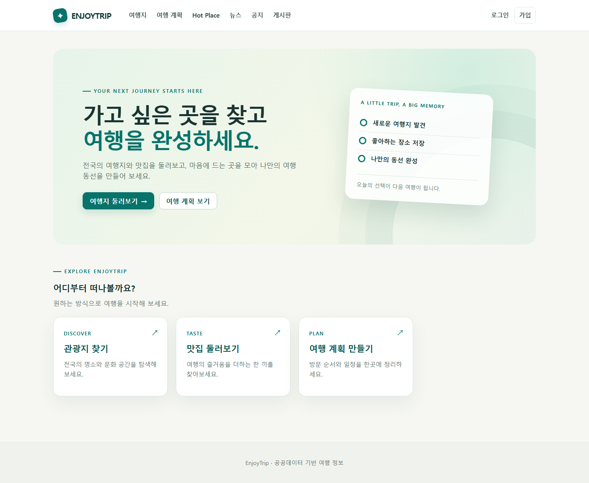

# EnjoyTrip

[실행 화면으로 보는 서비스 소개](deliverables/db/README.md) · [로컬 실행 안내](docs/db/06-local-test.md)

Servlet/JSP·JDBC·MySQL로 구현한 공공데이터 기반 여행 서비스입니다. [백엔드 개발 문서](docs/back/README.md), [DB 확장 설계](docs/db/README.md), [현재 개발·검증 결과](docs/db/05-progress.md)를 참고하세요.

## 문서

[서비스 소개와 DB 설계](deliverables/db/README.md)에 전체 12개 테이블 ERD·최종 DDL·실행 화면·검증 결과를 정리했습니다. [백엔드 설계](docs/back/README.md)와 [DB 확장 설계](docs/db/README.md)에서 구조와 구현 범위를 확인할 수 있습니다.

## 요구 환경

- Java 21, Tomcat 11, MySQL 8. Maven은 포함된 Wrapper가 자동으로 준비합니다.
- 한국관광공사 국문 관광정보 API, 한국천문연구원 출몰시각 API, 한국환경공단 충전소 API, OpenWeather API 키
- 지도 사용 시 브라우저 인터넷 연결(OpenStreetMap 타일 로드)

## 로컬 실행

1. 새 환경은 **`EnjoyTrip_db.sql` 하나로 DDL·기준정보·공개 관광지 데이터를 함께 준비**합니다. 개발용 DDL만 필요하면 `src/main/resources/schema.sql`과 `src/main/resources/db/seed/lookup-data.sql`을 차례로 실행합니다. 기존 DB는 백업·앱 중지 후 `src/main/resources/db/migrations/001-db-extension.sql`을 사용합니다. 기본 DB는 `enjoytrip`이며 [상세 안내](docs/db/06-local-test.md)를 참고하세요.
2. [.env.example](.env.example)을 참고해 Git에서 제외되는 `.env`에 실제 값을 입력합니다. `replace-me`는 예시값이므로 실제 MySQL·관리자 비밀번호로 바꿉니다. 실제 비밀번호나 API 키를 커밋하지 않습니다.
3. Windows는 `.\run-local.ps1`을 실행합니다. 스크립트가 Maven 빌드와 테스트를 수행하고 `.env`를 Tomcat 프로세스에 전달합니다. macOS/Linux는 `./mvnw clean package` 후 환경 변수를 설정한 Tomcat 11의 `webapps`에 `target/enjoytrip.war`를 배포합니다.
4. `http://localhost:8080/enjoytrip/health`에서 `OK`를 확인한 다음 `/enjoytrip/`에서 홈을 엽니다. 다른 포트는 `.\run-local.ps1 -Port 18080`으로 시작합니다. 앱·DB 도구·HTTP 검증은 모두 루트 `.env` 하나를 사용하며, 별도 `app.env`나 `-EnvFile` 옵션은 사용하지 않습니다.

| 환경 변수 | 용도 |
| --- | --- |
| `ENJOYTRIP_DB_URL`, `ENJOYTRIP_DB_USER`, `ENJOYTRIP_DB_PASSWORD` | MySQL JDBC 접속. Tomcat JNDI `jdbc/EnjoyTrip` DataSource가 있으면 이를 우선 사용 |
| `ENJOYTRIP_ADMIN_ID`, `ENJOYTRIP_ADMIN_EMAIL`, `ENJOYTRIP_ADMIN_PASSWORD` | 첫 실행 시 관리자 생성. 이미 존재하면 비밀번호를 변경하지 않음 |
| `ENJOYTRIP_TOUR_API_KEY` | 관광지·사진 수집 |
| `ENJOYTRIP_DATA_GO_API_KEY` | 일출·일몰과 충전소 조회. 각 API 활용 신청이 필요할 수 있음 |
| `ENJOYTRIP_WEATHER_API_KEY` | OpenWeather 현재 날씨·5일 예보 |
| `ENJOYTRIP_UPLOAD_DIR` | Hot Place 사진 저장 디렉터리. Tomcat 프로세스에 쓰기 권한 필요 |
| `ENJOYTRIP_SYNC_ENABLED` | 기본 true. false이면 정기·수동 관광지/뉴스 동기화 중지. 적재·격리 테스트에 사용 |

애플리케이션은 DB 테이블을 자동으로 만들지 않습니다. 관리자 계정은 스키마 적용 후 앱을 시작해야 생성됩니다. 외부 API 키가 없으면 해당 수집·부가 정보 기능만 사용할 수 없습니다. 관광지 목록은 마지막으로 저장된 DB 자료를 계속 조회합니다.

## 주요 기능

- 지역·유형·이름별 관광지 검색, 사진·지도·날씨·일출·충전소 조회
- 회원 가입·프로필·로그인·탈퇴와 관리자 비밀번호 초기화
- 날짜·경비·방문 순서를 기록하고 공개 링크로 공유하는 여행 계획
- 사진과 지도 위치를 저장하는 Hot Place
- 관광 뉴스 RSS, 관리자 공지사항, 회원 공유게시판

## 검증

`.\scripts\test.ps1`은 공통 `.env`를 읽고 8건 통과·DB 통합 1건 생략입니다. `python scripts/db/setup-test.py --with-attractions`로 테스트 DB를 준비한 뒤 `.\scripts\test.ps1 -Integration`을 실행하면 같은 서버·인증정보로 총 9건을 검증합니다. 별도 설정 파일·계정을 만들지 않습니다. [직접 테스트 안내](docs/db/06-local-test.md)와 [검증 결과](deliverables/db/verification.md)를 참고하세요.

`temp/`는 `.gitignore`에 포함되어 프로젝트 명세서 원본이 Git에 올라가지 않습니다.
