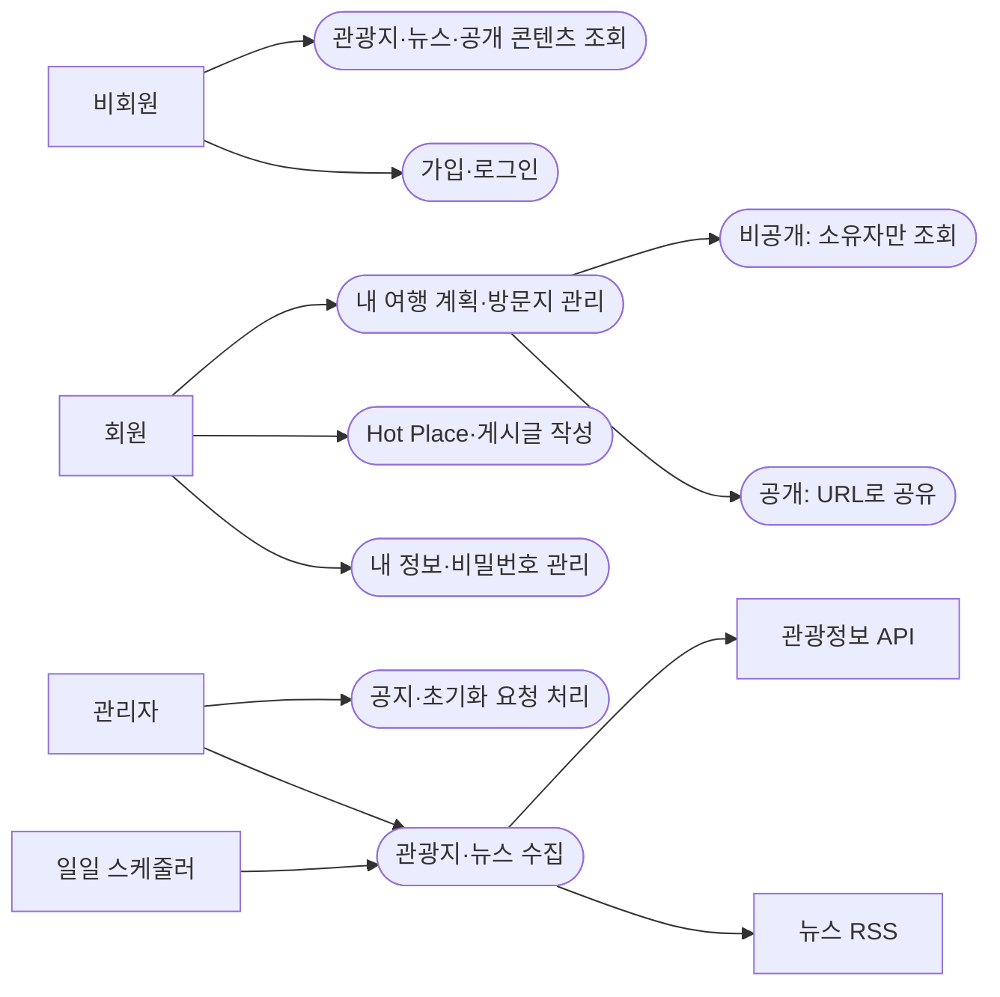
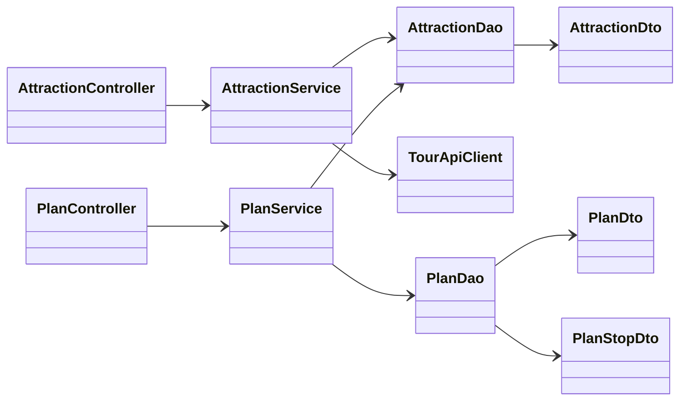
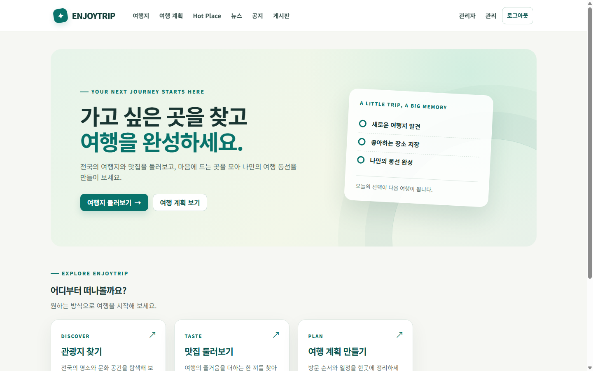
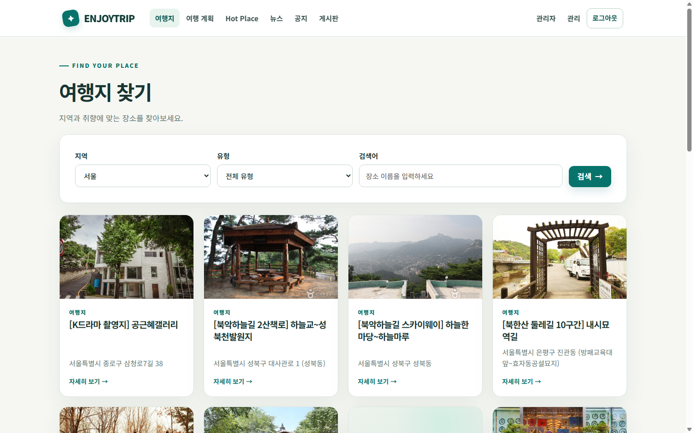
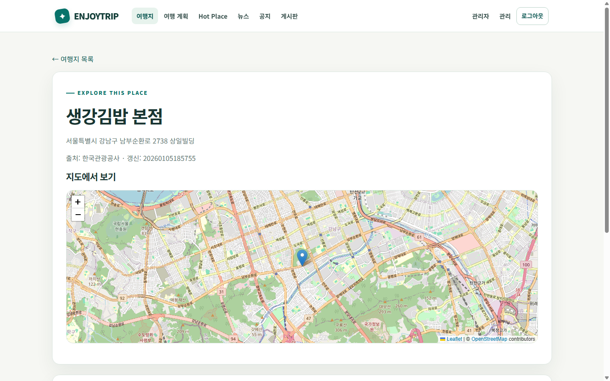
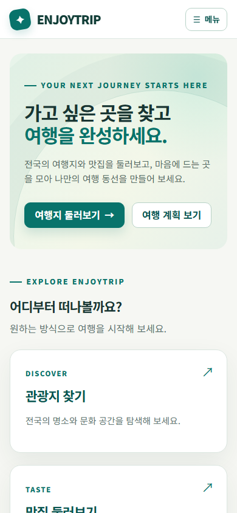

# EnjoyTrip 프로젝트 산출물

**Java 21 · Tomcat 11 · Servlet/JSP · JDBC · MySQL 8**로 구현한 여행 정보 서비스다. 요청은 `Servlet(Controller) → Service → Dao → Dto` 계층을 중심으로 처리하고 JSP에서 화면을 렌더링한다. 한국관광공사 관광정보, 뉴시스 RSS, 날씨·일출·충전소 API를 연동하며 지도는 **Leaflet/OpenStreetMap**을 사용한다.

이 폴더에는 제출용 문서와 **실제 실행 화면 캡처 17장**을 모았다.

| 문서 | 내용 |
| --- | --- |
| [개선된 요구사항 목록](requirements.md) | F101~F114 완료 기준, 권한·보안·실패 처리, 구현 근거 |
| [개선된 유즈케이스 다이어그램](use-cases.md) | 비회원·회원·관리자·스케줄러와 외부 시스템, 주요 예외 시나리오 |
| [개선된 클래스 다이어그램](class-diagrams.md) | 관광지, 여행 계획/콘텐츠, 회원/운영의 실제 클래스와 의존성 |
| [실행 화면 캡처 전체 목록](screenshots/README.md) | 17개 PNG의 경로·설명·캡처 조건 |

## 프로젝트 개요

방문자는 지역·유형·이름으로 관광지를 검색하고 상세 위치, 사진, 뉴스, 공지와 공개 여행 계획을 조회한다. 회원은 여행 계획의 방문지와 순서를 관리하고, 사진과 위치가 담긴 Hot Place 및 게시글을 작성한다. 관리자는 관광정보·뉴스 수집, 공지, 비밀번호 초기화 요청을 처리한다.

### 핵심 구현 원칙

- **권한:** 비공개 계획은 소유자만 볼 수 있다. 관리자도 다른 회원의 비공개 계획을 볼 수 없다.
- **데이터:** 관광지는 공공데이터 ID 기준으로 갱신하고, 뉴스는 원문 URL로 중복을 제거한다. 외부 API가 실패해도 저장된 목록을 조회한다.
- **지도:** 카카오맵 활성화가 필요 없는 Leaflet/OpenStreetMap으로 관광지·여행 동선·Hot Place의 지도와 마커를 표시한다.
- **보안:** PBKDF2 비밀번호 해시, 세션 ID 재발급, CSRF 검사, 역할·소유권 검사, 출력 이스케이프, PreparedStatement를 적용한다.
- **화면:** JSP 공통 레이아웃과 모바일 메뉴를 사용하며, 이미지 로드 실패·빈 결과·지도 타일 실패 시 안내한다.

## 실행 방법

1. **Java 21, MySQL 8, Tomcat 11**을 준비한다. Windows 기본 스크립트는 `C:\tools\app\apache-tomcat-11.0.26`을 사용하며, 다른 위치라면 `run-local.ps1 -TomcatHome '설치 경로'`를 지정한다.
2. MySQL에서 [`schema.sql`](reference/schema.sql)을 실행해 `enjoytrip` DB와 테이블을 만든다.
3. [`.env.example`](reference/.env.example)을 복사해 프로젝트 루트의 `.env`를 만들고 DB 사용자·비밀번호, 관리자 초기 계정, 사용할 외부 API 키, 사진 저장 경로를 입력한다. `.env`는 Git에 포함하지 않는다. **카카오 키는 필요 없다.**
4. 프로젝트 루트 PowerShell에서 다음을 실행한다. 8080 포트가 비어 있어야 한다.

```powershell
powershell -NoProfile -ExecutionPolicy Bypass -File .\run-local.ps1
```

5. [`/enjoytrip/health`](http://localhost:8080/enjoytrip/health)의 `OK`로 DB 연결을 확인하고 [홈](http://localhost:8080/enjoytrip/)을 연다. 관리자 계정으로 로그인한 뒤 `/enjoytrip/admin`에서 관광지 동기화를 시작할 수 있다. 실행 창에서 `Ctrl+C`로 종료한다.

필수 DB 설정, 오류별 점검과 환경 변수 설명은 [로컬 실행 안내](reference/docs/06-local-run.md)와 [프로젝트 루트 README](reference/README.md)에 있다. 외부 API 키나 활용 승인이 없으면 해당 실시간 기능은 사용하지 못하지만, 저장된 관광지·뉴스 목록과 기본 화면은 조회할 수 있다.

## 개선된 요구사항 요약

| ID | 사용자 기능 | 구체화한 완료 기준 |
| --- | --- | --- |
| F101~F103 | 관광지 탐색 | 17개 지역·8개 유형·이름 검색, 20건 페이지, 상세·빈 결과 |
| F104 | 여행 계획 | 기간·예산·방문 순서·동선, 공개 URL, 소유자 전용 비공개 계획 |
| F105 | Hot Place | 사진·방문일·설명·지도 좌표, 소유자 수정·삭제 |
| F106 | 관광 뉴스 | RSS 제목 필터, URL 중복 제거, 원문 링크, 새 건수 구분 |
| F107~F108 | 회원·인증 | 가입·프로필·탈퇴·로그인·비밀번호 초기화, 세션·CSRF 보호 |
| F109~F110 | 공지·게시판 | 관리자 공지, 회원 게시글, 작성자 권한 |
| F111~F114 | 관광지 부가 정보 | 날씨·사진·일출/일몰·주변 충전소, 연동 실패 시 부분 안내 |

각 항목의 입력 제한, 예외, 화면 증거와 외부 연동 검증 범위는 [요구사항 문서](requirements.md)에 정리했다.

## 개선된 유즈케이스 다이어그램



역할별 전체 유즈케이스, 외부 정보 조회와 실패·권한 시나리오는 [상세 다이어그램](use-cases.md)에 있다.


[유즈케이스 개요 SVG](diagrams/use-cases-overview.svg) · [UML 유즈케이스 SVG](diagrams/use-cases-uml.svg)

## 개선된 클래스 다이어그램



위는 핵심 경로의 축약도다. 회원, Hot Place, 공지/게시판, 뉴스, 외부 정보, Filter·스케줄러까지 포함한 **실제 클래스·주요 메서드·직접 DAO 호출 예외**는 [전체 클래스 다이어그램](class-diagrams.md)에 있다.



[클래스 개요 SVG](diagrams/classes-overview.svg) · [관광지 클래스 SVG](diagrams/classes-attractions.svg) · [콘텐츠 클래스 SVG](diagrams/classes-content.svg) · [회원·운영 클래스 SVG](diagrams/classes-auth-news.svg)

## 실제 실행 화면

2026-10-30(KST) `localhost:8080`의 실행 중인 앱을 Chrome으로 직접 열어 저장했다. 데스크톱은 1440×900, 모바일은 390×844이다. 이미지는 합성하거나 내용을 수정하지 않았다.

| 홈 | 서울 관광지 검색 |
| --- | --- |
| [](screenshots/01-home.png) | [](screenshots/02-attractions-seoul.png) |

| 관광지 상세 지도 | 모바일 홈 |
| --- | --- |
| [](screenshots/03-attraction-detail-map.png) | [](screenshots/14-home-mobile.png) |

여행 계획·Hot Place·좌표 선택 지도·뉴스·공지·게시판·로그인·관리자·작성 폼·모바일 메뉴까지의 나머지 13장은 [캡처 전체 목록](screenshots/README.md)에서 열 수 있다. 캡처 시점에 Hot Place 목록은 비어 있고 공개 계획에는 방문지가 없어, 해당 이미지를 CRUD 또는 경로 지도 성공 증거로 과장하지 않는다. 관리자 화면의 RSS 실패 상태도 실제 캡처 그대로 남겼다.

## 검증 결과와 해석

| 검증 | 확인 결과 |
| --- | --- |
| Maven `test package` | JUnit 4건 통과, WAR 생성 |
| Tomcat/MySQL | `/health`, 홈, 관광지, 계획, 뉴스, 공지, 게시판, 관리자·작성 화면이 HTTP 200 |
| 브라우저 지도 | 관광지 상세에서 OpenStreetMap 타일과 위치 마커 표시 |
| 반응형 | 390px 뷰포트에서 홈·관광지 목록 가로 넘침 없음, 모바일 메뉴 열림 |
| 실행 캡처 | 공개 화면 10장, 로그인 후 화면 4장, 모바일 화면 3장 저장 |

외부 기관 API의 응답과 뉴스 RSS 상태는 시점·승인·네트워크에 따라 달라진다. 이 문서는 **구현 상태**와 **이번 실행에서 눈으로 확인한 상태**를 구분한다. 실제 수집 건수와 이전 검증 기록은 [구현·검증 기록](reference/docs/05-implementation-status.md)에 있다.
