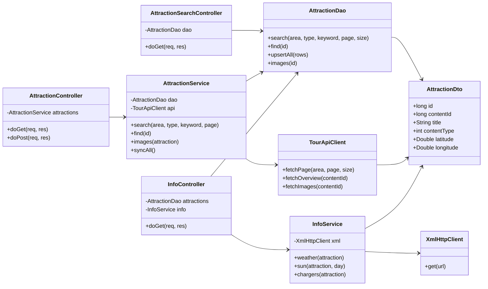
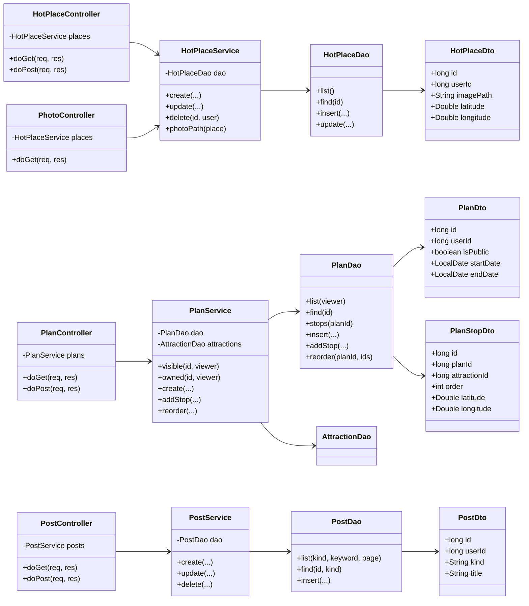
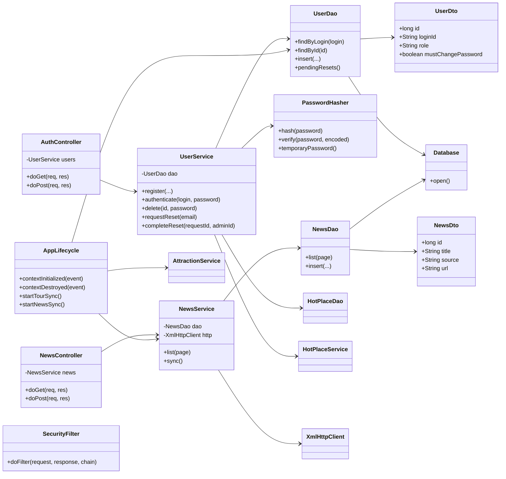
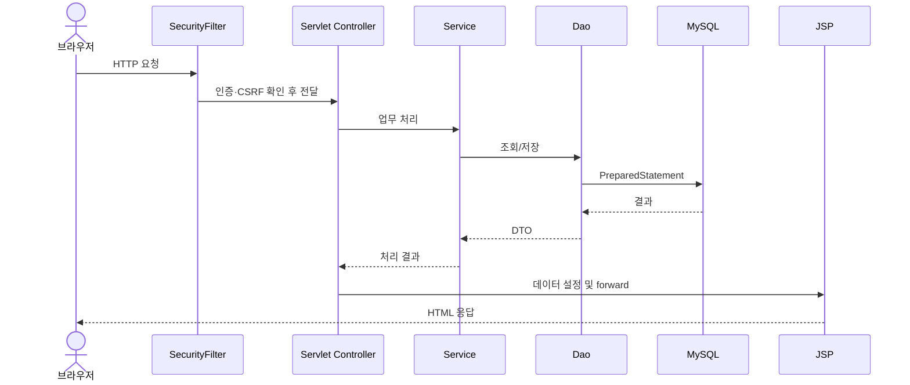

# 개선된 클래스 다이어그램

현재 `src/main/java/kr/co/enjoytrip`의 실제 클래스와 의존성을 기준으로 작성했다. 큰 그림을 한 장에 압축하지 않고 관광지·콘텐츠·회원/운영 세 영역으로 분리했다. 화살표는 **호출하거나 보유하는 방향**이다.

## 1. 관광지 검색과 외부 정보

`AttractionSearchController`와 `InfoController`는 각각 `AttractionDao`를 직접 사용한다. 이 예외를 숨기지 않고 실제 구현대로 표시했다. JSP는 Controller가 선택하는 뷰이며, 지도는 브라우저의 `maps.js`와 Leaflet에서 렌더링한다.

[관광지 클래스 다이어그램 SVG](diagrams/classes-attractions.svg)

## 2. 여행 계획, Hot Place, 글

`PlanService.visible`은 공개 여부와 소유자를 검사하고 `owned`는 수정 권한을 검사한다. `HotPlaceService`가 사진 파일 형식·크기와 저장 경로를 관리한다. 공지와 게시판은 `PostDto.kind`로 구분하고 `PostService`가 관리자/작성자 권한을 검사한다.

[콘텐츠 클래스 다이어그램 SVG](diagrams/classes-content.svg)

## 3. 회원, 뉴스, 공통 운영

`SecurityFilter`는 모든 요청 앞에서 세션·CSRF·관리자 경로 접근을 검사한다. DAO들은 공통 `Database`를 통해 JDBC 연결을 얻는다. `AppLifecycle`은 관리자 초기 계정 생성과 수집 스케줄러를 시작한다. DTO는 Java `record`로 구현했다.

[회원·뉴스·운영 클래스 다이어그램 SVG](diagrams/classes-auth-news.svg)

## 계층 간 요청 흐름

[요청 흐름 시퀀스 SVG](diagrams/request-sequence.svg)
