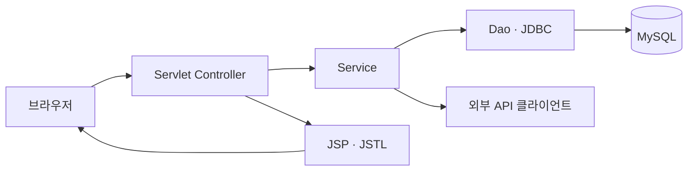
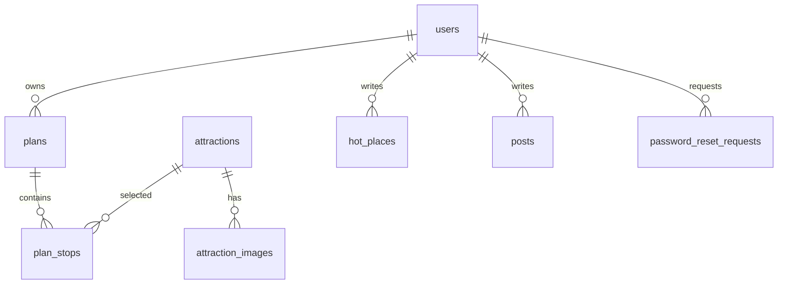
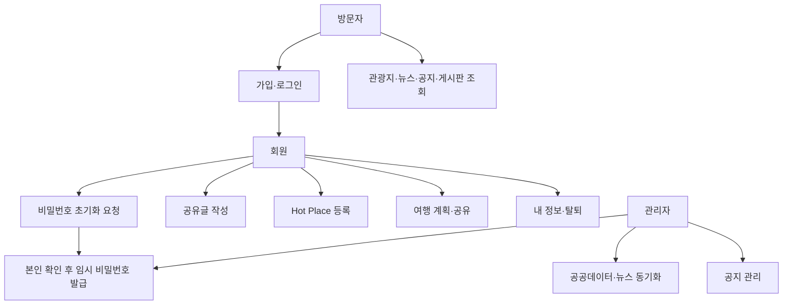
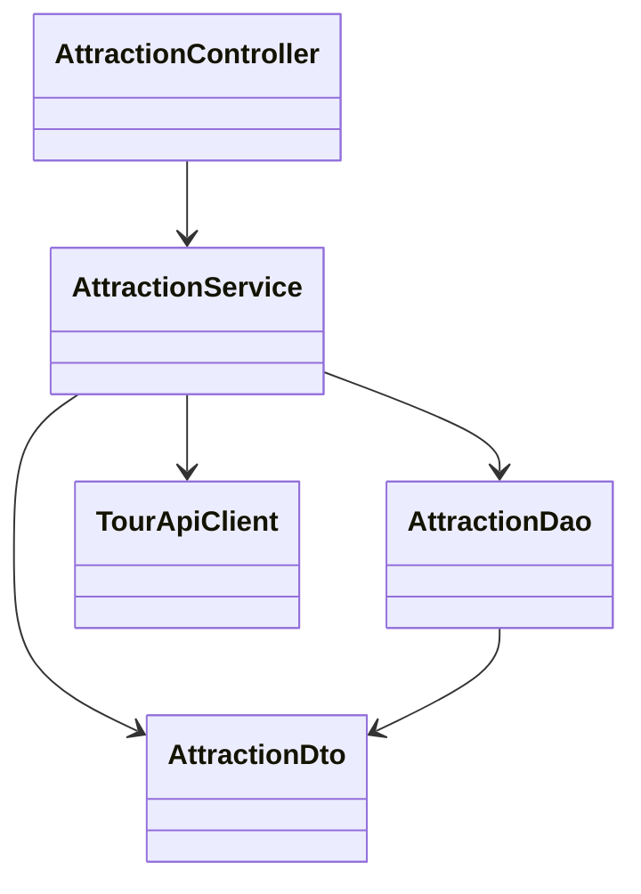

# 시스템 설계

## 기술 구성과 책임

Java 21, Maven WAR, Tomcat 11, Jakarta Servlet/JSP, JSTL, JDBC, MySQL 8을 사용한다. 화면은 서버 렌더링 JSP를 기본으로 하고 지도·드래그앤드롭·부가 정보만 JavaScript로 비동기 처리한다. `src/main/java`는 `controller`, `service`, `dao`, `dto`, `external`, `filter`, `config` 등 책임별 패키지로 구성한다. JSP는 `WEB-INF/views`에 두어 Servlet을 거치지 않는 직접 접근을 막는다.

| 계층 | 책임 |
| --- | --- |
| Servlet Controller | 요청 매핑, 파라미터 수집, HTTP 상태·리다이렉트·JSP 선택, 세션 확인 결과 전달 |
| Service | 입력·권한 검증, 업무 규칙, 트랜잭션 경계, 외부 데이터와 DB 조합 |
| Dao | PreparedStatement 기반 SQL과 결과 매핑. 화면·세션 로직을 두지 않음 |
| Dto | 화면·계층 간 전달 데이터. 원본 API 응답 객체와 분리 |
| 외부 API 클라이언트 | 인증 키 적용, 타임아웃·응답 파싱·오류 변환. 서버용 키를 브라우저에 노출하지 않음 |

DB 연결은 Tomcat JNDI `jdbc/EnjoyTrip` DataSource가 설정되면 이를 사용하고, 없으면 환경 변수로 MySQL JDBC에 직접 연결한다. 여행 순서와 비밀번호 초기화의 다중 테이블 변경은 한 트랜잭션으로 처리한다. HTTP 요청 본문과 JSP 출력은 UTF-8로 처리한다.

## 주요 화면과 요청

| 영역 | 화면/기능 | 경로와 메서드 |
| --- | --- | --- |
| 홈·관광지 | 홈, 목록, 상세, 지역·유형 검색 | `GET /`, `GET /attractions`, `GET /attractions/{id}` |
| 관광지 부가 정보 | 날씨·일출·사진·충전소 JSON | `GET /api/attractions/{id}/weather`, `/sun`, `/photos`, `/chargers` |
| 회원·인증 | 가입, 로그인, 로그아웃, 내 정보, 수정, 탈퇴 | `GET/POST /signup`, `GET/POST /login`, `POST /logout`, `GET /me`, `POST /me`, `POST /me/delete` |
| 비밀번호 | 초기화 요청과 임시 비밀번호 변경 | `GET/POST /password-reset`, `GET/POST /password-change` |
| 여행 계획 | 목록·상세·작성·수정·삭제·순서 변경 | `GET /plans`, `GET /plans/{id}`, `GET/POST /plans/new`, `GET/POST /plans/{id}/edit`, `POST /plans/{id}/delete`, `POST /api/plans/{id}/stops/order` |
| Hot Place | 목록·상세·작성·수정·삭제 | `GET /hot-places`, `GET /hot-places/{id}`, `GET/POST /hot-places/new`, `GET/POST /hot-places/{id}/edit`, `POST /hot-places/{id}/delete` |
| 뉴스 | 저장된 관광 뉴스 목록 | `GET /news` |
| 공지·게시판 | 목록·상세·작성·수정·삭제 | `GET /notices`, `/posts` 및 각 `{id}`; 생성·수정·삭제는 대응 `POST` |
| 관리자 | 동기화, 초기화 요청 처리 | `GET /admin`, `POST /admin/sync/{source}`, `POST /admin/password-resets/{id}/complete` |
| 상태 확인 | DB 연결 상태 | `GET /health` (`200 OK` 또는 `503 DB unavailable`) |

`{id}`는 양의 정수로 검증한다. 목록은 `page`, `size`, `region`, `type`, `keyword` 등의 쿼리를 사용하며 허용한 정렬값만 받는다. 변경 성공 후에는 PRG(Post/Redirect/Get)를 적용한다. JSON API는 성공 시 데이터와 조회 시각을 주고, 실패 시 HTTP 상태와 사용자에게 표시할 오류 메시지를 준다. 모든 URL은 애플리케이션 컨텍스트 경로를 기준으로 생성한다.

## 데이터 모델

| 테이블 | 핵심 필드와 제약 |
| --- | --- |
| `users` | PK, 고유 로그인 ID·이메일, 비밀번호 해시, 이름, `USER/ADMIN` 역할, 임시 비밀번호 변경 필요 여부, 생성 시각 |
| `attractions` | PK, 고유 공공데이터 `content_id`, 유형·지역 코드, 이름·주소·좌표·소개, 대표 사진 URL, 원본 갱신 시각, 수집 시각; 지역·유형·이름 인덱스 |
| `attraction_images` | PK, 관광지 FK, 원본 사진 URL·출처·표시 순서, `(attraction_id, image_url)` 고유값 |
| `plans` | PK, 회원 FK, 제목, 시작·종료일, 총 예상 경비, 상세 설명, 공개 여부, 생성·수정 시각 |
| `plan_stops` | PK, 계획·관광지 FK, 방문 날짜, 순서, 예상 경비, 메모; 계획 내 순서 고유값 |
| `hot_places` | PK, 회원 FK, 제목·장소명·유형·방문일·설명·좌표, 서버 사진 경로, 생성·수정 시각 |
| `news` | PK, 고유 원문 URL, 제목·출처·발행 시각·수집 시각 |
| `posts` | PK, 회원 FK, `NOTICE/BOARD` 유형, 제목·본문·생성·수정 시각; 공지는 ADMIN 작성 |
| `password_reset_requests` | PK, 회원 FK, 요청·처리 시각, `PENDING/COMPLETED` 상태, 처리 관리자 FK |

여행 일정의 순서는 날짜별로 저장한다. 공개 계획만 비로그인 조회를 허용한다. 회원 탈퇴는 관련 사용자 콘텐츠를 한 트랜잭션에서 삭제한다. 관광지 데이터는 사용자 콘텐츠와 독립적으로 유지한다. Hot Place 사진은 설정된 저장 디렉터리에 UUID 파일명으로 저장하고 DB에는 상대 경로만 기록한다. 업로드는 이미지 MIME·실제 파일 형식·용량을 검증한다.

## 외부 연동과 실패 처리

- 관광지·사진: 수집 Service가 페이지 단위로 받아 공공데이터 ID로 upsert한다. 수집 이력을 로그에 남기고 실패 페이지는 재시도 가능하게 한다. 관리자 수동 실행과 일일 예약 실행을 같은 Service에 연결한다.
- 뉴스: 뉴시스 문화·지방·수도권 RSS에서 관광·여행 관련 제목을 필터링해 URL 기준 중복 제거한다. 새로 저장된 건수와 확인한 기사 건수를 구분해 표시하고, 일일 실행하며 원문 링크로 이동시킨다.
- 날씨: OpenWeather의 좌표 기반 5일·3시간 예보를 호출한다. 같은 관광지의 반복 요청은 짧게 캐시하고 최신 조회 시각을 표시한다.
- 일출·일몰: 한국천문연구원 API에 선택 날짜와 관광지 좌표를 보낸다. 화면 표기는 한국 시간대(`Asia/Seoul`)로 통일한다.
- 충전소: 한국환경공단 API의 위치·상태를 받아 관광지 주변 항목만 보여준다. 상태 갱신 시각을 함께 표시한다.
- Leaflet/OpenStreetMap 지도: 관광지·Hot Place·계획 경유지 마커와 방문 순서를 그린다. 브라우저에서 타일을 직접 요청하며 출처 표기를 표시한다.

외부 호출은 연결·읽기 타임아웃을 적용한다. 사용자 요청에서 API가 실패해도 저장된 주요 콘텐츠 화면은 유지하고, 해당 부가 정보 영역에만 오류를 표시한다. 키가 없는 로컬 환경은 외부 연동 테스트용 가짜 응답을 사용한다.

## 사용자 흐름

## 주요 클래스 관계

회원, 여행계획, Hot Place, 게시판, 뉴스, 부가 정보에도 같은 Controller → Service → Dao/외부 클라이언트 → Dto 책임 분리를 적용한다. 공통 인증·권한 검사는 Filter와 Service 양쪽에서 수행해 URL 우회와 직접 Service 호출을 모두 방어한다.
