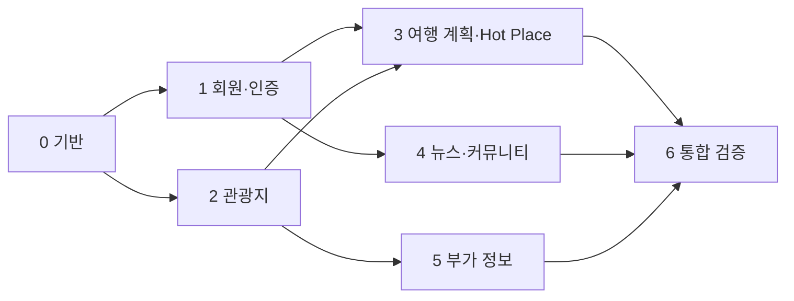

# 단계별 구현 계획

각 단계는 이전 단계의 완료 기준을 충족한 뒤 진행한다. 기능은 항상 **Dto → Dao → Service → Servlet Controller → JSP/JavaScript** 순서로 연결하고, 해당 단계의 주요 흐름을 검증한다. 모든 단계에서 비밀번호·API 키·업로드 파일을 Git에 넣지 않는다.

## 0. 기반과 실행 환경

1. Maven WAR 프로젝트와 Maven Wrapper를 만들고 Java 21, Tomcat 11, Jakarta Servlet/JSP, JSTL, MySQL JDBC 의존성을 설정한다.
2. 공통 레이아웃·메뉴·오류 화면과 UTF-8 설정, DataSource, 환경 변수 로딩, DB 스키마 초기화 스크립트를 만든다.
3. `README.md`에 MySQL 생성, 환경 변수, 공공 API 키, Tomcat 배포, 첫 관리자 생성 방법을 기록한다. `.env.example`은 변수명만 포함한다.

**완료:** 깨끗한 환경에서 WAR를 빌드하고 Tomcat에 배포해 홈과 `/health`의 DB 연결 결과를 확인할 수 있다. 실제 비밀값 없이 단위 테스트를 실행할 수 있다.

## 1. 회원·인증·권한 (F107~F108)

1. 회원 가입, 로그인, 로그아웃, 프로필 조회·수정, 탈퇴를 구현한다. 비밀번호 해시와 세션 재발급을 적용한다.
2. 로그인·관리자 Filter, 변경 요청 CSRF 검증, 소유자 검증, 관리자 초기 계정 생성 절차를 추가한다.
3. 사용자 초기화 요청과 관리자 처리 목록, 본인 확인 후 임시 비밀번호 발급, 첫 로그인 시 비밀번호 변경을 구현한다.

**완료:** 가입부터 탈퇴까지 이어지고, 비로그인·일반회원의 관리자 접근이 차단된다. 임시 비밀번호 사용 후 변경 요구가 동작한다.

## 2. 관광지 데이터와 탐색 (F101~F103, F112)

1. 한국관광공사 API 클라이언트, 원본 ID 기반 수집·갱신 Service, 관리자 수동 실행과 일일 예약 실행을 만든다.
2. 관광지·사진 Dao 및 지역·유형·키워드 검색, 페이지 이동, 상세 조회를 구현한다.
3. 관광지 목록·상세 JSP와 Leaflet 지도 마커, 사진 갤러리, 누락 정보 안내를 연결한다.

**완료:** 같은 데이터를 두 번 수집해도 중복이 없고, F102·F103의 모든 유형과 지역 조건으로 검색된다. 외부 API 장애 중에도 마지막 저장 데이터가 조회된다.

## 3. 여행 계획과 Hot Place (F104~F105)

1. 계획·방문지·Hot Place 테이블과 CRUD를 구현한다. 계획의 날짜·경비·상세 메모와 공개 여부를 저장한다.
2. 관광지를 계획에 추가하고 드래그앤드롭으로 날짜별 방문 순서를 바꾼 뒤, 순서 변경을 한 트랜잭션으로 저장한다. 지도에 순서와 경로를 표시한다.
3. Hot Place 사진 업로드·검증·삭제와 장소 지도 표시를 구현한다.

**완료:** 저장 후 다시 열어도 일정·동선·사진이 유지된다. 비공개 계획과 타인 콘텐츠의 변경은 차단되고 공개 계획은 공유 URL로 조회된다.

## 4. 뉴스와 커뮤니티 (F106, F109~F110)

1. 뉴시스 문화 RSS 수집, 관광 관련 제목 필터, 원문 URL 기준 중복 제거, 뉴스 목록을 구현한다.
2. 공지사항과 공유게시판의 목록·상세·등록·수정·삭제를 구현한다. 본문 출력은 이스케이프한다.
3. 게시판 페이지 이동과 글 검색을 추가한다.

**완료:** 수집을 반복해도 뉴스가 중복되지 않고 원문 링크가 열린다. 공지는 관리자만 변경하며, 공유글은 작성자만 변경한다.

## 5. 실시간 부가 정보 (F111, F113~F114)

1. OpenWeather 예보, 한국천문연구원 일출·일몰, 한국환경공단 충전소 API 클라이언트를 구현한다.
2. 관광지 상세의 날씨·일출·일몰 영역과 주변 충전소 지도·목록을 비동기로 연결한다. 조회·상태 갱신 시각을 표시한다.
3. 호출 타임아웃, 짧은 캐시, 빈 응답·키 누락·제공자 장애 처리와 사용자 안내를 구현한다.

**완료:** 좌표·날짜에 맞는 정보가 표시되고, 각 API가 실패해도 관광지 상세와 다른 부가 정보가 정상 동작한다.

## 6. 통합 검증과 제출 산출물

1. [검증 계획](04-test-plan.md)의 시나리오와 모바일·데스크톱 화면을 확인한다. DB 초기화부터 관리자 생성·데이터 수집·회원 사용 흐름까지 새 환경에서 재현한다.
2. README의 실행 절차를 검증하고, 최종 요구사항 목록·Usecase/Class Diagram·소스코드·실행 화면 캡처를 정리한다.
3. `git status`와 `git check-ignore temp/backend-requirements.pdf`로 제외 대상과 제출 대상을 확인한다.

**완료:** 요구사항별 검증 결과와 실행 화면을 남기고, 공개 저장소에 비밀값·`temp/`·빌드 산출물이 포함되지 않는다.

## 단계 간 선행 조건

