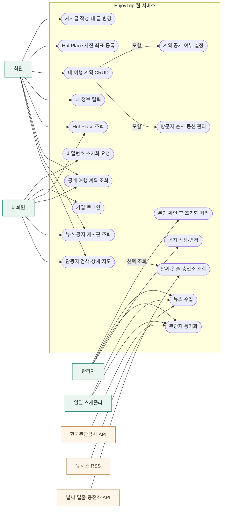

# 개선된 유즈케이스 다이어그램

역할별 권한과 외부 시스템의 경계를 분리했다. 원본 명세의 기능 목록에 구현 중 확정된 **비공개 계획의 소유자 전용 규칙**과 **관리자 수동/일일 자동 수집**을 반영했다.

## UML 유즈케이스 다이어그램

```mermaid
usecase-beta
direction LR
actor Guest("비회원")
actor Member("회원")
actor Admin("관리자")
actor Scheduler("일일 스케줄러")
actor Tour("한국관광공사 API")
actor RSS("뉴시스 RSS")
actor Extra("날씨·일출·충전소 API")
systemBoundary App["EnjoyTrip 웹 서비스"]
  Browse("관광지 검색·상세·지도")
  Read("뉴스·공지·게시판 조회")
  PublicPlan("공개 계획 조회")
  HotRead("Hot Place 조회")
  Auth("가입·로그인")
  ResetReq("비밀번호 초기화 요청")
  Profile("내 정보·탈퇴")
  Plan("내 여행 계획 관리")
  Stops("방문지·순서·동선 관리")
  Publish("계획 공개 설정")
  HotWrite("Hot Place 사진·좌표 등록")
  BoardWrite("게시글 작성·내 글 변경")
  NoticeWrite("공지 작성·변경")
  ResetDone("본인 확인 후 초기화 처리")
  SyncTour("관광지 동기화")
  SyncNews("뉴스 수집")
  ExtraInfo("날씨·일출·충전소 조회")
end
Member --|> Guest
Admin --|> Member
Guest --> Browse
Guest --> Read
Guest --> PublicPlan
Guest --> HotRead
Guest --> Auth
Guest --> ResetReq
Member --> Profile
Member --> Plan
Member --> HotWrite
Member --> BoardWrite
Admin --> NoticeWrite
Admin --> ResetDone
Admin --> SyncTour
Admin --> SyncNews
Scheduler --> SyncTour
Scheduler --> SyncNews
Tour --> SyncTour
RSS --> SyncNews
Extra --> ExtraInfo
Stops ..> : extend Plan
Publish ..> : extend Plan
ExtraInfo ..> : extend Browse
```

방문지 추가, 계획 공개, 외부 부가 정보 조회는 기본 조회·계획 저장의 선택 단계이므로 `«extend»`로 표시했다. [렌더링한 SVG](diagrams/use-cases-uml.svg)도 제공한다.

## 역할·외부 시스템 연결도



> 관리자는 회원이기도 하지만 **다른 회원의 비공개 여행 계획을 조회할 수 없다.** 공개 계획은 누구나, 비공개 계획은 소유자만 조회한다.

## 주요 시나리오와 예외

| 유즈케이스 | 선행 조건 | 기본 흐름 | 예외·권한 규칙 |
| --- | --- | --- | --- |
| 관광지 검색 | 없음 | 지역/유형/이름 입력 → DB 검색 → 20건씩 표시 → 상세·지도 조회 | 빈 결과 안내. 외부 API 장애 시 저장된 자료 조회 유지. |
| 여행 계획 작성 | 로그인 | 제목·기간·예산 저장 → 관광지 선택 → 방문일·순서·메모 저장 → 동선 확인 | 기간 밖 방문일 거부. 타인의 수정·삭제 거부. |
| 여행 계획 공유 | 계획 소유자 | 공개 여부 설정 → 공개 URL로 상세 조회 | 비공개 계획은 소유자 외 404. 관리자도 동일. |
| Hot Place 등록 | 로그인 | 장소 정보·사진 입력 → 지도에서 좌표 선택 → 저장 → 상세 조회 | 사진 형식·크기 검증. 수정·삭제는 소유자만. |
| 관광 뉴스 조회 | 없음 | DB의 관광 기사 제목·출처·발행일 표시 → 원문 이동 | 새 기사 없으면 중복 저장 없음. RSS 장애 시 기존 기사 유지. |
| 공지·게시판 | 공지 작성은 관리자, 게시글 작성은 회원 | 목록/상세 조회 → 권한에 맞는 글 작성·수정·삭제 | 다른 사람의 게시글 변경 거부. 비회원은 조회만. |
| 비밀번호 초기화 | 가입한 이메일 | 사용자 요청 → 관리자 본인 확인 → 임시 비밀번호 발급 → 다음 로그인 시 변경 | 일반 회원의 관리자 처리 접근 거부. 임시 비밀번호는 처리 직후 한 번만 표시. |
| 관리자 수집 | 관리자 또는 스케줄러 | 관광정보/RSS 요청 → 필터·중복 검사 → DB 저장 → 상태 표시 | 실패 원인·부분 저장 건수 표시. 중복 실행 방지. |

## 화면에서 확인할 경로

- 비회원: [관광지 검색](screenshots/02-attractions-seoul.png) → [상세와 지도](screenshots/03-attraction-detail-map.png), [뉴스](screenshots/07-news.png), [공지](screenshots/08-notices.png), [게시판](screenshots/09-board.png)
- 회원: [계획 작성](screenshots/13-plan-form.png), [Hot Place 작성](screenshots/12-hot-place-form.png), [좌표 선택 지도](screenshots/12b-hot-place-map.png)
- 관리자: [수집과 초기화 요청 처리 화면](screenshots/11-admin.png)
