# EnjoyTrip — 여행지를 찾고, 나만의 여행을 기록하다


EnjoyTrip은 국내 관광지를 지역·유형으로 찾아 여행 계획에 담고, 방문 사진과 장소를 공유하는 서비스입니다. Servlet·JSP로 화면을 제공하고 JDBC·MySQL로 회원, 관광지, 여행 일정, Hot Place와 게시글을 저장합니다.

이 문서의 화면은 **현재 프로젝트 루트 `.env`의 `3306/enjoytrip`에 연결된 실제 앱**에서 2026-11-06(KST)에 새로 캡처했습니다. 관광지 **51,622건**, 시도 17개·구군 234개·관광 유형 8개를 사용합니다. 화면을 합성하거나 성공 상태로 바꾸지 않았습니다.

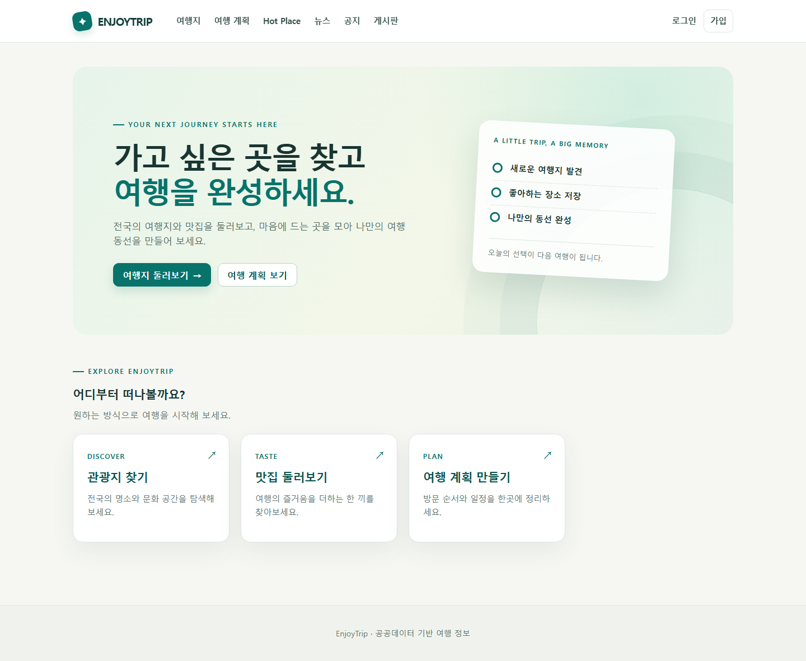

## 서비스 이용 흐름

**여행지 검색 → 사진·지도·여행 정보 확인 → 일정·경비·방문 순서 저장 → 공개 계획 공유 → Hot Place·게시판으로 경험 나누기**

### 1. 지역과 취향에 맞는 여행지 탐색

서울 관광지, 제주 숙박, 지역별 음식점처럼 지역·유형·이름을 조합해 검색합니다. 선택지는 MySQL 기준정보에서 읽고 관광지는 20건씩 조회합니다. 상세에서는 대표 사진·설명·위치를 확인할 수 있습니다.

| 서울 관광지 검색 | 관광지 상세·지도 |
| --- | --- |
| [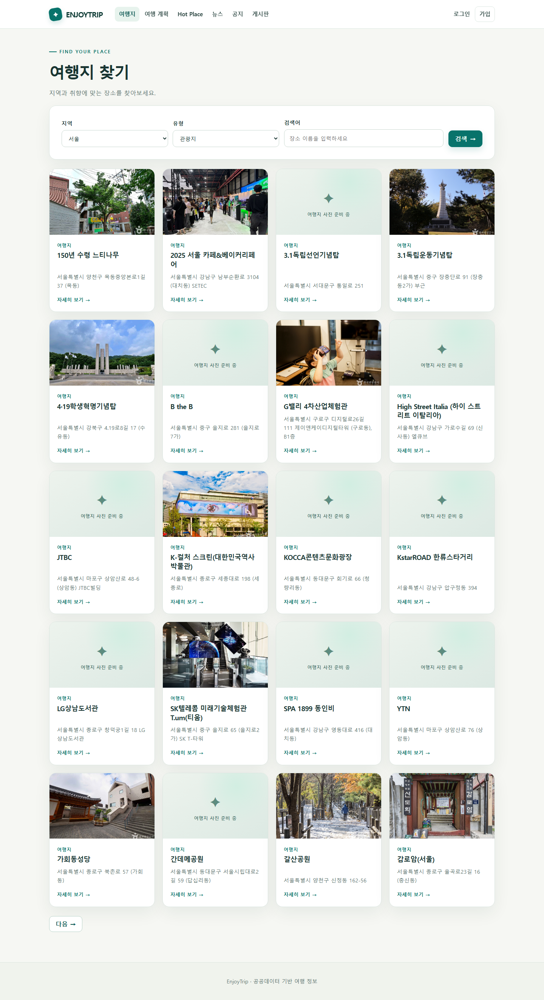](screenshots/02-attractions-seoul.png) | [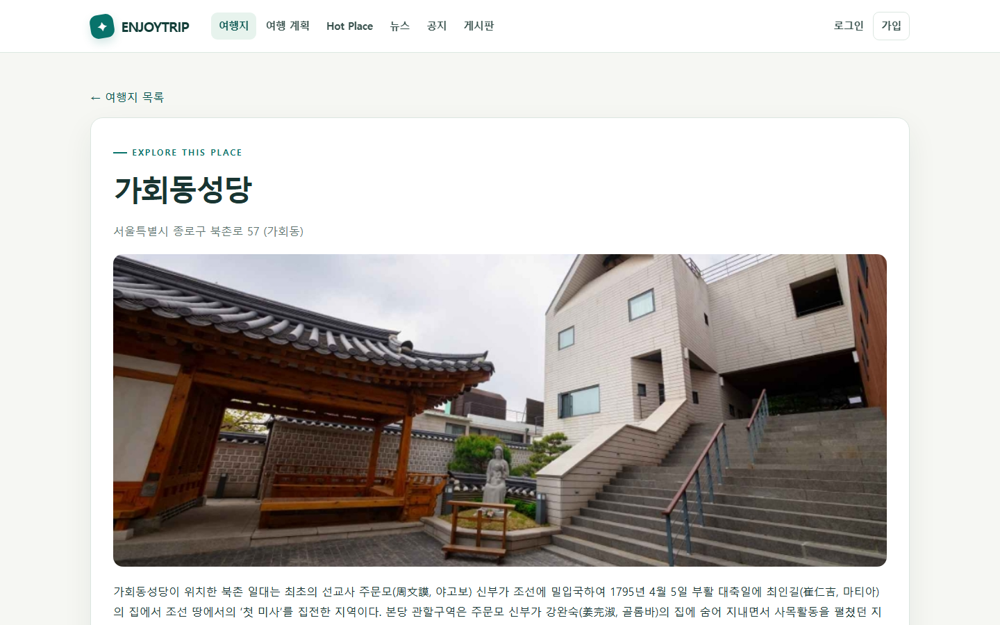](screenshots/03-attraction-detail.png) |

### 2. 나만의 일정·경비·동선 저장

회원은 여행 기간·예산·상세 계획을 정하고, 검색한 관광지를 방문지로 추가합니다. 방문 순서를 변경하면 DB에 저장되고 지도에 동선이 표시됩니다. 공개 계획은 URL로 공유하며 비공개 계획은 작성자만 볼 수 있습니다.

| 계획 목록 | 일정·방문지 2개·지도 동선 |
| --- | --- |
| [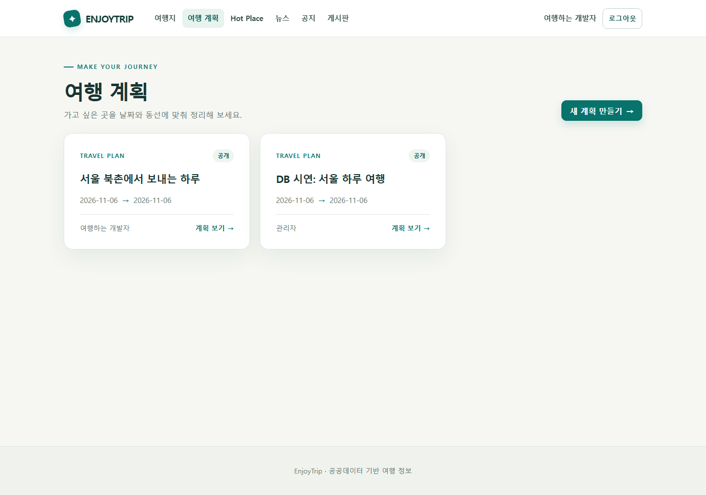](screenshots/08-plan-list.png) | [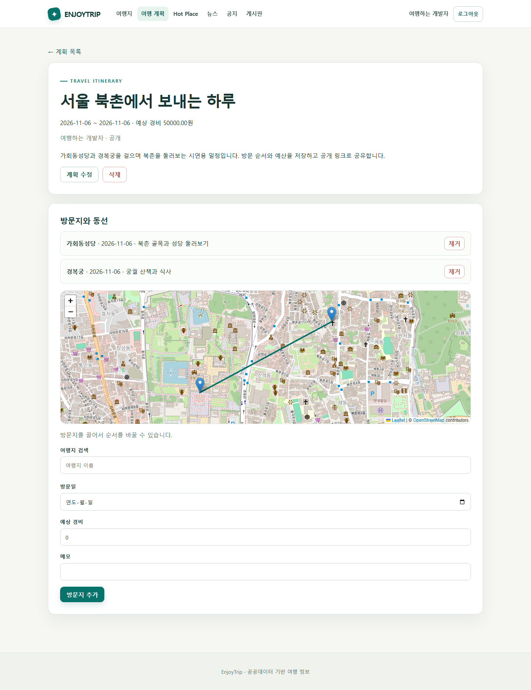](screenshots/09-plan-detail.png) |

### 3. 사진과 함께 남기는 Hot Place

방문일·장소 유형·설명·사진·지도 위치를 함께 기록합니다. 사진은 파일로, 작성자와 기록 정보는 MySQL에 저장하며 본인만 수정·삭제할 수 있습니다. 아래는 실제 등록한 **서비스 시연용 기록**입니다. 사용한 사진의 출처는 한국관광공사입니다.

| Hot Place 목록 | 사진·방문일·위치 상세 |
| --- | --- |
| [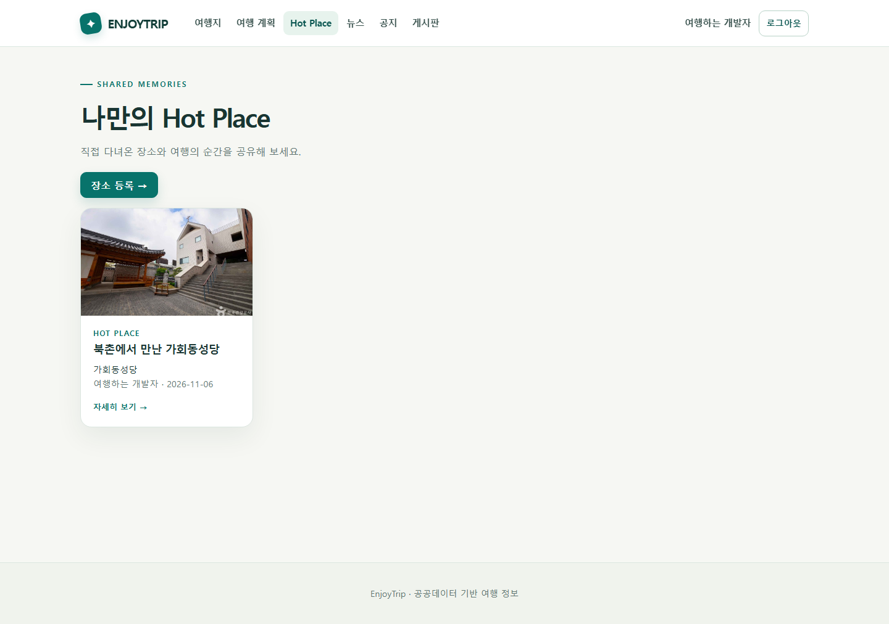](screenshots/11-hot-list.png) | [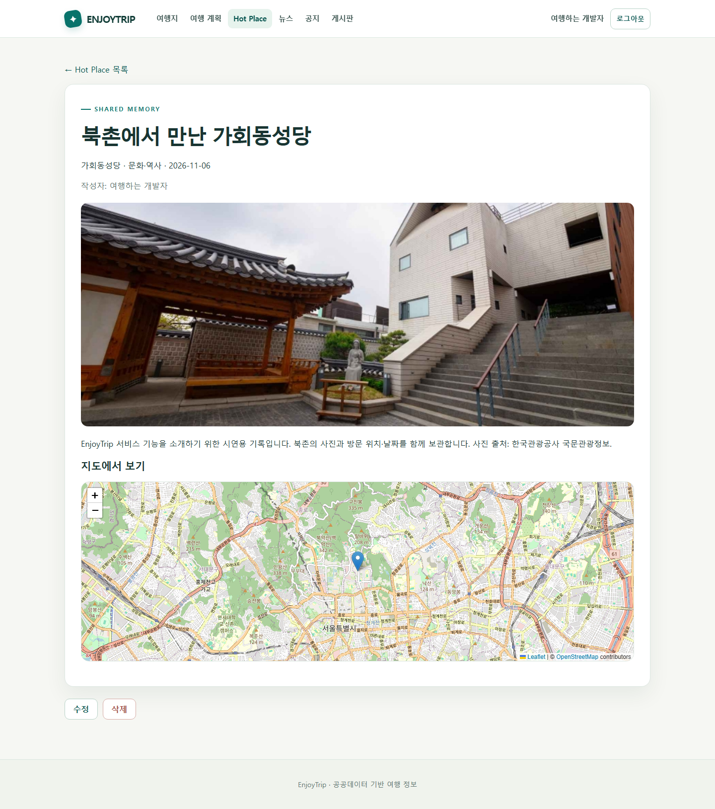](screenshots/12-hot-detail.png) |

### 4. 여행 뉴스와 커뮤니티

수집한 관광 관련 RSS 뉴스를 읽고 원문으로 이동할 수 있습니다. 공지는 관리자가 작성하고, 공유게시판은 회원이 여행 정보를 등록·수정·삭제합니다. 글은 작성자 권한과 출력 이스케이프를 적용합니다.

| 실제 수집 뉴스 | 여행 정보 공유게시판 |
| --- | --- |
| [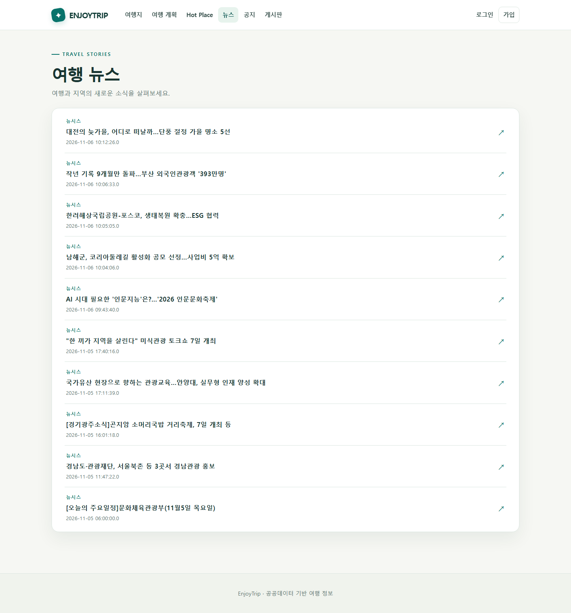](screenshots/05-news.png) | [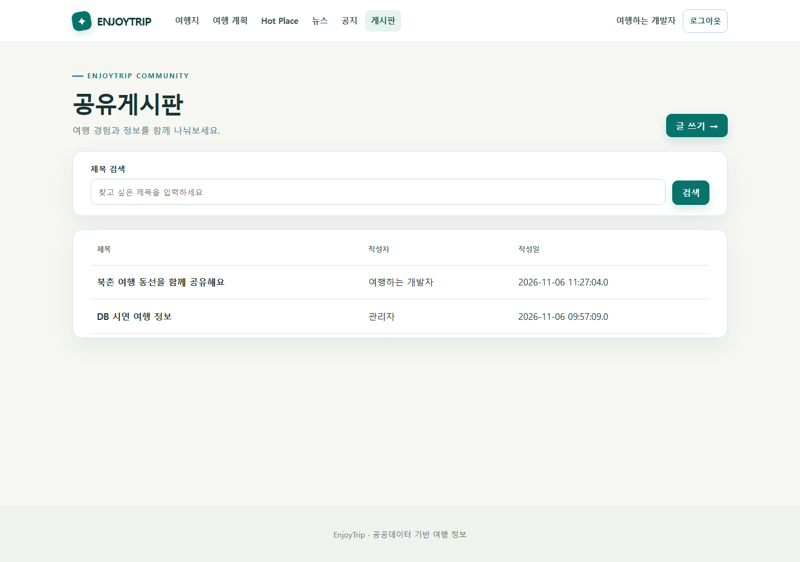](screenshots/14-board.png) |

### 5. 여행에 필요한 부가 정보와 모바일 화면

관광지 좌표로 현재 날씨·예보와 날짜별 일출·일몰을 조회합니다. 이번 캡처에서는 날씨·일출·일몰 API가 HTTP 200을 반환했습니다. 충전소는 응답 지연으로 이번 성공 증거에 포함하지 않았습니다. 모바일에서도 검색·메뉴·주요 화면을 사용할 수 있습니다.

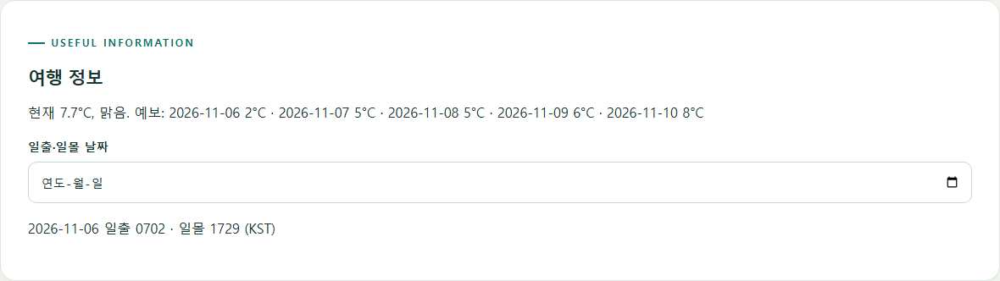

모바일 화면은 [홈](screenshots/17-home-mobile.png), [지역·유형 검색](screenshots/18-attractions-mobile.png), [메뉴 열기](screenshots/19-mobile-menu.png)에서 확인할 수 있습니다. [전체 실행 화면 19장](screenshots/README.md)에는 로그인·회원 정보·등록 폼·관리자 화면도 포함합니다.

## 기술·구조와 데이터베이스

| 영역 | 적용 기술·책임 |
| --- | --- |
| 웹 | Java 21 대상, Servlet/JSP, JSTL, Maven WAR, Tomcat 11 |
| 데이터 | JDBC·PreparedStatement, MySQL 8, PK/FK/UNIQUE/INDEX·트랜잭션 |
| 계층 | Controller의 요청 처리 → Service의 업무·검증 → DAO의 SQL → DTO 전달 |
| 지도 | Leaflet·OpenStreetMap의 마커·방문 동선·위치 선택 |
| 인증·권한 | PBKDF2 해시, 세션 재발급, CSRF, 관리자·작성자·비공개 계획 검사 |
| 설정 | 루트 `.env` 하나. 실제 값은 제출 ZIP·Git에 포함하지 않음 |

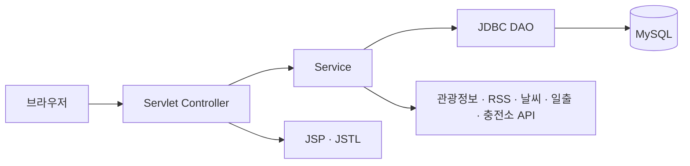

회원·여행 계획·방문지·사진·Hot Place·공지/공유글·뉴스·초기화 요청과 시도·구군·유형을 **12개 테이블**로 모델링했습니다. 구군은 시도와 함께 식별하고 `(area_code,sigungu_code)` 복합 FK로 지역 정합성을 보장합니다. 원본 공공 ID `content_id`와 앱 내부 `id`를 구분해 기존 계획·사진 참조를 보존합니다.

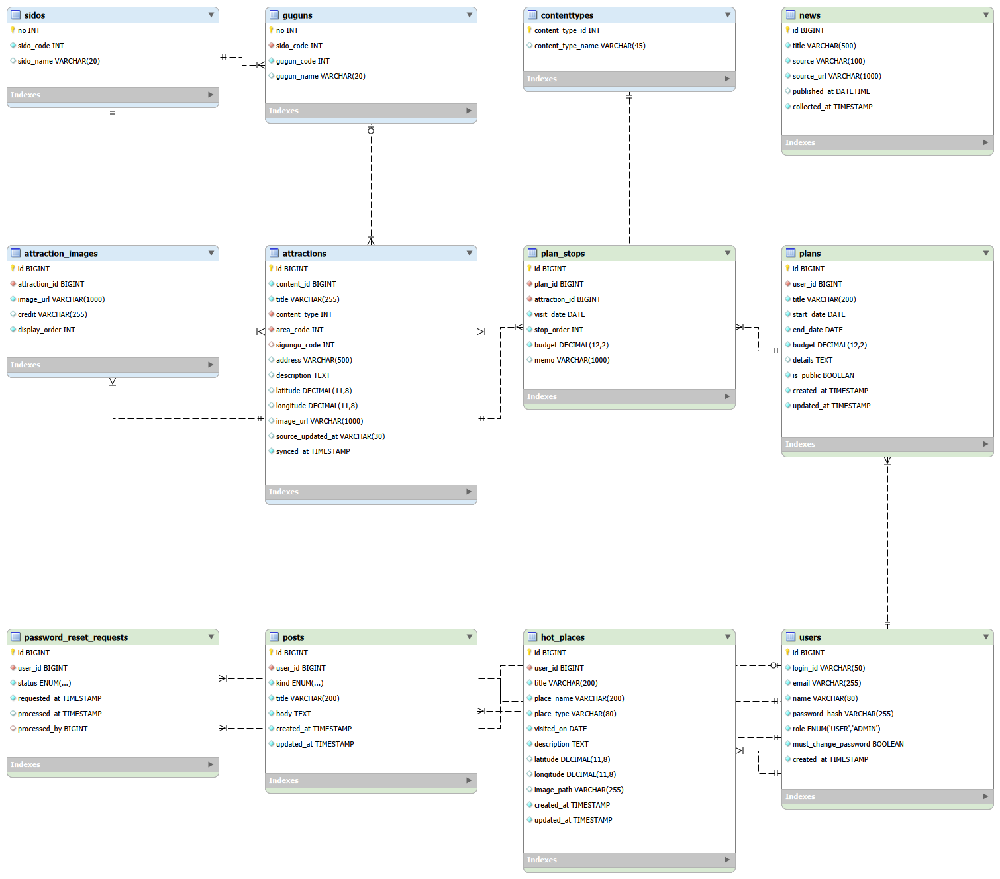

[전체 컬럼·제약 설명](erd.md) · [Workbench 편집 모델](EnjoyTrip_db.mwb) · [DDL 원본](schema.sql) · [Mermaid/SVG 보조 자료](erd.svg)

Workbench 자동 생성은 [공식 Workbench 소스의 저장·PNG 내보내기 API](https://github.com/mysql/mysql-workbench/blob/8.0/backend/wbprivate/workbench/wb_module.cpp)를 확인하고, 설치된 Workbench에서 실제 저장·재열기로 검증했습니다.

## 필수 제출물

| 필수 조건 | 준비 파일·확인 결과 |
| --- | --- |
| `x.mwb` | [EnjoyTrip_db.mwb](EnjoyTrip_db.mwb) — 실제 Workbench에서 생성·다시 열기 검증, 12개 테이블·그림·FK |
| `x.sql` | [EnjoyTrip_db.sql](EnjoyTrip_db.sql) — 전체 DDL＋공개 관광지/사진/기준정보. 별도 빈 DB에서 12개 테이블·관광지 51,622건 복원 확인 |
| `x.png`(ERD) | [EnjoyTrip_db.png](EnjoyTrip_db.png) — 같은 Workbench 모델에서 직접 내보낸 ERD |
| 실행 화면·서비스 소개 | 이 README, [19개 새 캡처](screenshots/README.md), [캡처 환경·응답 기록](screenshots/capture-manifest.json) |
| 소스·실행 안내 | **별도 소스코드 ZIP**의 `dbtrip/src`, `pom.xml`, Maven Wrapper, 실행 스크립트. [상세 테스트 안내](reference/local-run.md) |

제출 SQL에는 **실제 회원·관리자·비밀번호 해시·개인 작성글·업로드 파일을 내보내지 않았습니다.** 실행 화면의 계획·Hot Place·글은 별도로 등록한 시연 자료입니다. 새 환경에서는 직접 회원 가입 후 같은 기능으로 작성할 수 있습니다.

## 새 환경 실행

1. Java 21 이상 JDK, MySQL 8, Tomcat 11을 준비합니다. 이번 실행은 Java 25 JDK의 `release 21`, MySQL 8.0.46, Tomcat 11.0.26으로 검증했습니다.
2. **새 빈 DB 환경**에서 필수 SQL `EnjoyTrip_db.sql`을 실행합니다. 기본 DB는 `enjoytrip`이며 기준정보·관광지를 함께 준비합니다. 기존 DB를 사용한다면 백업 후 [업그레이드 안내](reference/local-run.md#기존-db-업그레이드)를 따릅니다.
3. **소스코드 ZIP을 따로 압축 해제**하고 그 안의 `.env.example`을 `.env`로 복사해 MySQL 접속·관리자·업로드 경로와 사용할 API 키를 설정합니다. DB 산출물 ZIP에는 [설정 예시](reference/.env.example)만 참고용으로 포함합니다. 실제 `.env`는 제출하지 않습니다.
4. 소스코드 ZIP의 `dbtrip/`에서 실행합니다. 기본 Tomcat 경로가 다르면 `-TomcatHome '설치 경로'`를 지정합니다.

```powershell
.\run-local.ps1
```

5. `http://localhost:8080/enjoytrip/health`의 `OK`를 확인한 뒤 [홈](http://localhost:8080/enjoytrip/)을 엽니다. 현재 작업 환경의 실행 포트는 18080입니다.

단위·DB 통합·HTTP·권한·복구의 명령과 기대 결과는 [직접 테스트 안내](reference/local-run.md), 실제 실행 범위는 [검증 기록](verification.md)에 있습니다. 설정 키가 있어도 승인·제공자 응답은 별도로 확인해야 합니다.

