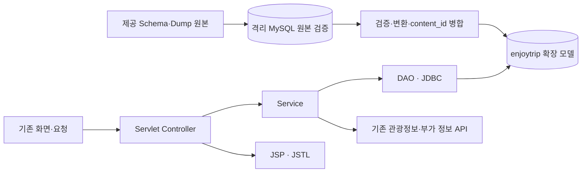
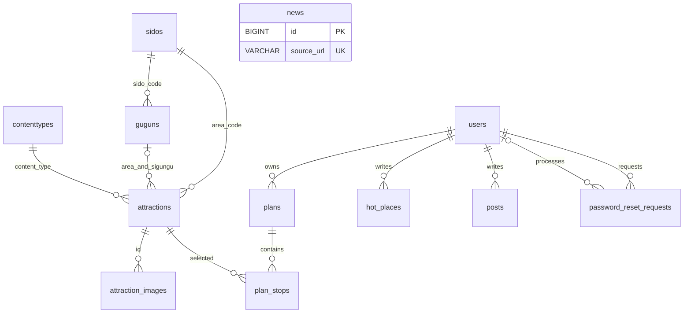

# DB 연계 및 계층 설계

## 설계 기준과 대안 선택

**[명세]** 신규 PDF p.3~5는 관계 모델·제약·DDL·초기 데이터·Service/DAO 연동을 요구하며, 제공 테이블·컬럼의 원형 사용을 강제하지 않는다. **[사용자 답변]** 원형 사용 의무가 없다면 기존 구조 유지 및 제공 데이터 혼합을 허용했다. 따라서 **B안을 구현 계획 기준**으로 삼는다. 기존 데이터·URL 보존은 기존 기능 유지를 위한 설계 선택이다.

| 대안 | 구조 | 변경과 영향 | 판단 |
| --- | --- | --- | --- |
| A. 제공 구조 직접 채택 | `trip_source.attractions(no,content_type_id,...)`를 주 테이블로 사용하고 사용자 콘텐츠 테이블 통합 | 관광지 SQL·DTO·수집, 사진·계획 FK 타입과 값, 기존 ID→새 no 매핑, 상세 URL 호환 변경. 구군 관계 결함도 별도 보완 필요 | 별도 제출 규칙이 원형 사용을 요구할 경우 재검토. 현재 기준 아님 |
| B. 기존 구조 확장·변환 적재 | 기존 `enjoytrip`의 9개 테이블·관광지 내부 `id` 유지, 기준정보 3개 추가, 덤프 검증 후 `content_id`로 병합 | 기존 참조·URL 보존. 기준정보·관광지 매핑·구군 적재·DDL·초기화/업그레이드 절차 중심 변경 | 사용자 조건과 기존 기능 유지 원칙에 부합. 이하 상세 설계의 기준 |

Spring·JPA·MyBatis 전환, 회원·게시판 전면 재설계, REST API 전면 교체는 계획하지 않는다. 수동 SQL 마이그레이션을 먼저 설계하며 새 마이그레이션 도구 도입을 필수로 만들지 않는다.

## 처리 구조

원본 SQL은 자체 스키마 이름을 명시한다. 로더 생성 시 이를 `trip_source`로 정규화하고 변환 SQL도 같은 이름을 사용한다. 기본 DB만 바꿔 원본을 직접 실행하지 않고 별도 인스턴스 등 격리 환경을 사용한다. 환경·권한은 Q5에서 준비한다. 이 설계의 최초 작성 시에는 검증 환경 생성이나 DB 접속을 수행하지 않았다.

## 목표 관계 모델

다음은 B안의 전체 관계 초안이다. 최종 ERD에는 컬럼·NULL·고유키·삭제 정책까지 표현한다. 구군과 관광지는 시도·구군 코드 쌍으로 연결한다.

뉴스는 독립 테이블이므로 관계선이 없어도 전체 ERD에 포함한다. `news.source_url`의 현재 UNIQUE는 선두 255문자 인덱스이며 URL 전체의 고유 제약과는 다르다. 이번에 이를 신설하는 것으로 설명하지 않는다.

| 테이블 | 목표 키·제약·NULL·기본값 | 변경 구분 |
| --- | --- | --- |
| `sidos` | 제공 `no INT` PK 유지, `sido_code INT NOT NULL UNIQUE`, `sido_name VARCHAR(20)` | 신규. 참조키는 no가 아닌 sido_code |
| `guguns` | `no INT` PK, `sido_code/gugun_code INT NOT NULL`, `gugun_name VARCHAR(20)`, 복합 UNIQUE `(sido_code,gugun_code)`, sidos FK | 신규. 복합 UNIQUE는 제공 모델 개선 |
| `contenttypes` | `content_type_id INT` PK, `content_type_name VARCHAR(45)` | 신규. 39번 명칭은 Q4에서 결정 |
| `attractions` | 기존 `id BIGINT` PK, `content_id BIGINT NOT NULL UNIQUE` 유지. area_code→sidos, content_type→contenttypes, `(area_code,sigungu_code)`→guguns FK 추가 | 기존 코드 정합성 검증 후 FK 적용. sigungu_code는 NULL 허용. 지역·유형·제목 인덱스 유지 |
| `attraction_images` | attractions.id FK CASCADE, `(attraction_id,image_url(255))` UNIQUE, display_order 기본값 0 | 구조 유지. 참조·사진·순서 검증 |
| `users` | login_id/email UNIQUE, USER/ADMIN, must_change_password 기본값 FALSE | 구조 유지. 기존 ID·해시 유지 |
| `plans` | users FK CASCADE, 날짜·DECIMAL 예산, is_public 기본값 FALSE | 구조 유지. 날짜·금액 검증은 기존 Service |
| `plan_stops` | plans FK CASCADE, attractions FK 삭제 제한, `(plan_id,visit_date,stop_order)` UNIQUE, 예산 기본값 0 | 구조 유지. attraction_id 유지 |
| `hot_places` | users FK CASCADE, 방문일·설명·선택 좌표·사진 상대 경로 | 구조 유지. 사진 파일도 보존 |
| `posts` | users FK CASCADE, kind NOTICE/BOARD, 기존 kind/created_at 인덱스 | 구조 유지 |
| `password_reset_requests` | user_id FK CASCADE, processed_by FK SET NULL, status 기본값 PENDING | 구조 유지. 요청자·처리자 두 관계 구분 |
| `news` | id PK, source_url(255) UNIQUE, published_at NULL 허용, collected_at 기본값 CURRENT_TIMESTAMP | 구조 유지 |

기준정보 FK는 ON DELETE/UPDATE RESTRICT를 제안한다. 이름은 갱신할 수 있지만 참조 중인 코드를 지우거나 관광지를 연쇄 삭제하지 않는다. 새로운 CHECK·인덱스는 기존 검증과 실행계획을 확인한 뒤 필요한 경우에만 추가한다.

## 제공 관계 보완과 MySQL 호환성

제공 `attractions.si_gun_gu_code → guguns.gugun_code`는 시도를 포함하지 않아 지역 소속을 보장하지 못한다. `gugun_code` 단독 UNIQUE를 만들지 않고 부모의 복합 UNIQUE와 자식의 복합 FK로 보완한다. 자식의 구군 코드가 NULL이면 구군 미설정으로 허용하되 시도 FK는 별도로 검증한다.

MySQL 8.4에서 비고유키 참조는 비표준 호환 기능으로 비권장 처리되며 관련 설정의 영향을 받는다. 따라서 제공 DDL을 모든 MySQL 8 환경에서 무조건 실행 가능하다고 보지 않는다. [MySQL 8.4 FK 공식 문서](https://dev.mysql.com/doc/refman/8.4/en/create-table-foreign-keys.html)를 참고하고, 실제 버전 및 `restrict_fk_on_non_standard_key`의 존재·값을 확인한다. 서버 제약을 완화하는 설정 변경을 기본 해결책으로 삼지 않는다.

격리 환경에서도 원본 FK가 거부되면 컬럼 순서·타입을 유지하고 복합 FK를 적용한 파생 DDL로 로드한다. 원본은 보존하고 차이·실행 결과를 기록한다. 검사를 해제했다 다시 켰다는 이유만으로 적재된 데이터가 정합하다고 판단하지 않는다.

## 관광지 필드 대응

| 제공 관광지 필드 | B안 저장·활용 | 변환·보존 기준 |
| --- | --- | --- |
| `no INT` | 원본 검증 환경·대조 기록 | 앱 id에 대입하지 않음. 기존 행의 id는 유지, 신규 행만 앱 AUTO_INCREMENT |
| `content_id INT NULL` | `content_id BIGINT NOT NULL UNIQUE` | 같은 공공 ID로 연결. NULL/중복은 검증 중단 대상 |
| `title VARCHAR(500)` | 기존 `title VARCHAR(255)`, Dto.title | 초과값을 자르지 않음. 이번 덤프는 정적 검사상 기존 길이 이내. 미래 초과값은 별도 확장 판단 |
| `content_type_id` | `content_type`, Dto.contentType | 같은 정수 코드, 유형 기준정보 검증 |
| `area_code` | `area_code`, Dto.areaCode | 같은 정수 코드, 시도 기준정보 검증 |
| `si_gun_gu_code` | 기존 `sigungu_code`, Dto에 nullable `Integer sigunguCode` 추가 | NULL 54건 유지. getObject 등으로 NULL과 0 구분 |
| `addr1`, `addr2` | 기존 `address VARCHAR(500)` | 비어 있지 않은 값을 공백으로 연결하고 앞뒤 공백 제거 |
| `overview` | 기존 `description TEXT` | 기존 API와 일치하는 개행·태그 제거로 텍스트화. NULL/빈 값으로 기존 설명을 지우지 않음 |
| `latitude/longitude DECIMAL(20,17)` | 기존 `DECIMAL(11,8)`, nullable Double DTO | 소수 8자리 반올림을 명시. 위경도 순서·범위 확인. 0 좌표는 아래의 결측 처리안 적용 여부 결정 |
| `first_image1` | 기존 `image_url VARCHAR(1000)` | 빈 값은 사진 없음. 기존 유효 URL을 빈 값으로 덮어쓰지 않음 |
| `first_image2` | 원본·검증 자료로 보존 | 별도 사진으로 간주해 갤러리에 이중 등록하지 않음. 추가 표시를 새 요구로 만들지 않음 |
| `map_level`, `tel`, `homepage` | 원본·대응표로 보존 | 기존 DTO·화면 대응 없음. 지도 축척·전화·HTML 링크 표시를 이번 기능으로 추가하지 않음 |
| 대응 필드 없음 | `source_updated_at` | 덤프 신규 행은 NULL. 기존 값은 유지. 덤프 생성일을 관광지 원본 갱신일로 저장하지 않음 |
| 대응 필드 없음 | `synced_at` | 실제 저장·수정 시각. 원본의 정보 갱신 시각과 구별 |

앱에서 사용하지 않는 원본 필드는 원본 SQL과 변환표로 추적한다. 모든 원본 필드를 운영 테이블의 새 컬럼으로 추가할 의무는 명세에서 확인되지 않았다. 추가 보존·화면 표시가 별도 수용 조건으로 확인되면 그때 변경 범위를 검토한다.

## 적재·전환·복구

다음은 **설계 제안**이며 Q3~Q4의 충돌·보정 정책은 실제 적용 전에 확정한다.

1. 원본 해시·건수·문자셋·덤프 주석 시점을 기록하고 원본을 편집하지 않는다. 필요한 개선 DDL·보정은 별도 파일로 작성한다.
2. 격리 환경에서 Schema 또는 호환 보완 DDL→Dump 순으로 실행한다. 시도→구군→유형→관광지의 부모·자식 순서를 지킨다. 원본 Dump는 컬럼명 없는 INSERT이므로 확장된 앱 테이블에 직접 실행하지 않는다.
3. 17/234/8/50,915건, 유형 분포, 중복·고아·결측을 검증한다. 원본의 `SET NAMES utf8`과 클라이언트 인코딩도 확인하고 파생 스크립트는 UTF-8·utf8mb4로 통일한다.
4. 기존 DB 백업·복원을 검증 환경에서 확인하고 content_id↔id, 계획·사진 FK, 사용자 테이블 건수·파일 목록을 보관한다. 코드 불일치가 있으면 FK 적용 전에 자료를 확인하며 자동 삭제·임의 지역 배정을 하지 않는다.
5. 기준정보는 자연키로 반복 실행 가능하게 적재한다. 승인된 39번 명칭 보정은 원본과 구분해 기록한다. 원본 no와 코드, AUTO_INCREMENT 시작값과 건수를 혼동하지 않는다.
6. 관광지는 content_id로 연결해 기존 id를 유지한다. 오래된 덤프로 현재의 비어 있지 않은 값을 덮어쓰지 않고 신규 행·확인된 결측만 보충하는 안을 권장한다. 기존 description/source_updated_at와 덤프에 없는 기존 관광지는 유지한다. 변경·충돌 목록을 먼저 출력한다.
7. 0 좌표가 있는 64행은 원본값을 기록한 뒤 앱에서는 위도·경도를 모두 NULL로 처리하는 안을 제안한다. 범위 밖 값도 미확정 데이터로 기록한다. 기존 정상 좌표의 대체는 Q3 정책을 따른다. NULL을 0으로 바꾸지 않는다.
8. 변환 DML은 명시적 트랜잭션 단위로 실행하고 재실행 시 중복·id/FK 변화가 없는지 확인한다. 무관한 사용자 테이블의 데이터를 변경하지 않는다. 제약 적용 후에도 고아 검사를 수행한다.
9. DB·DAO가 일치하는 WAR로 검증한 뒤 전환한다. 전환 중 관리자·정기 동기화를 멈추고 검증 후 재개한다. 실패 구간과 수동 재실행 지점을 기록하며 자동 재개가 구현되어 있다고 가정하지 않는다.

신규 추가 수는 `덤프 content_id 집합 − 기존 content_id 집합`이다. 통합 후 건수는 기존 수＋신규 추가 수이며 반드시 50,915건이 되지는 않는다. 원본 검증 환경과 통합 앱 DB의 기대 건수를 분리한다.

DDL과 LOCK TABLES에는 암묵적 커밋 동작이 있으므로 전체 과정을 하나의 ROLLBACK으로 되돌릴 수 있다고 설계하지 않는다. DDL·DML을 나누고 DB 백업·이전 WAR·접속 설정·사진의 일관된 복구 절차를 준비한다. [MySQL 8.4 암묵적 커밋 공식 문서](https://dev.mysql.com/doc/refman/8.4/en/implicit-commit.html)를 근거로 한다.

## 계층별 변경

Java 경로는 `src/main/java/kr/co/enjoytrip/` 기준이다. 신규 클래스 이름은 후속 구현 제안이며 이번에 파일을 생성하지 않았다.

| 대상 | 변경 내용 | 유지·검증 기준 |
| --- | --- | --- |
| `dto/AttractionDto.java` | nullable Integer sigunguCode 추가, 모든 생성부 반영 | 기존 id/contentId 및 JSP 필드 유지 |
| `dto/SidoDto.java`, `GugunDto.java`, `ContentTypeDto.java` 신규안 | 코드·명칭, 구군은 부모 시도 포함 | no를 검색 코드로 사용하지 않음 |
| `dao/LookupDao.java` 신규안 | 시도·유형 목록, 부모 시도별 구군, 코드 존재 확인 | PreparedStatement, 구군 단독 전역 검색 금지 |
| `dao/AttractionDao.java` | 명시적 SELECT, 구군 매핑·쓰기, 기존 컬럼 기준 변환·upsert, NULL 보존 | 목록 20건＋다음 페이지 판단 1건. OFFSET은 표시 수 20 기준, 자동완성 최대 10건 |
| `service/AttractionService.java` | 기준정보·코드 검증·최대 10건 자동완성, 저장된 관광지만 읽는 `findStored` 메서드로 접근 통합 | 21건 목록 메서드를 자동완성에 그대로 적용하지 않음. 기존 `find`의 설명 보충용 외부 호출과 읽기 전용 조회를 구분 |
| `external/TourApiClient.java` | sigungucode를 nullable로 읽고 DTO에 전달 | 빈 값과 미등록 양수 코드를 구분. 기존 API·타임아웃 유지 |
| `AttractionDao.upsert/upsertAll` | INSERT/UPDATE 모두 구군 반영, API·덤프 병합 정책 구분 | id 재발급 금지, 기존 설명을 빈 값으로 지우지 않음. 미등록 양수 코드는 기록·중단 |
| `controller/AttractionController.java` | DB 기준정보를 목록 요청 속성으로 전달 | region/type/keyword/page, 상세 URL 유지 |
| `controller/AttractionSearchController.java` | DAO 직접 접근을 Service로 이동 | q 조건, id/title JSON, 최대 10건 유지 |
| `controller/InfoController.java` | 관광지 조회를 Service의 `findStored`로 이동 | InfoService·JSON·날짜 제한·부분 오류 유지. 기존 `find`의 외부 설명 수집을 부가 API 요청에 새로 발생시키지 않음 |
| `config/AppLifecycle.java` | 적재·전환 시 예약·수동 동기화 통제, 필요할 때만 최소 설정 추가 | 현재 관광지 예약은 키가 있을 때 시작 2분 후, 뉴스는 1분 후 실행 |
| `config/Database.java`, `AppConfig.java` | 원칙적으로 유지, JNDI·환경변수의 실제 DB 일치 확인 | 상시 두 DB 조회나 접속 전환 UI 추가 없음 |
| `dao/PlanDao.java`, `service/PlanService.java` | B안에서는 원칙적으로 수정 없이 참조 회귀 검증 | 기존 attractions.id JOIN·소유권·일정·순서 유지 |
| 회원·Hot Place·게시판·뉴스·SecurityFilter | 원칙적으로 변경 없음 | 기존 인증·권한·CSRF·탈퇴·파일 처리 유지 |

실제 API 코드 체계와 덤프 기준정보의 일치 여부는 동기화 전에 검증한다. 미등록 코드를 임의 생성하거나 잘못된 구군을 조용히 NULL로 바꾸지 않는다. 신규 다중 쓰기를 DAO로 구현한다면 하나의 Connection을 전달해 트랜잭션을 공유하며 테이블별 독립 접속으로 원자성을 주장하지 않는다. 초기 전환은 SQL 절차를 기본으로 하고 이관용 REST API·업로드 화면을 추가하지 않는다.

## API·화면 영향

| 기존 요청 | 이번 계획 |
| --- | --- |
| `GET /`(index.jsp→/home), `GET /home` | 유지 |
| `GET /attractions?region=&type=&keyword=&page=` | URL 유지. 선택지를 DB 기준정보로 변경. 검색값은 기존 코드 |
| `GET /attractions/{id}` | 기존 내부 id 유지. 덤프 no/content_id로 바꾸지 않음. 결측·출처·갱신 시각 미상 안내 확인 |
| `GET /api/attractions/search?q=` | Service 경유로만 변경. id/title JSON·10건 상한·plan.js 호환 |
| `GET /api/attractions/{id}/weather`, `/sun?date=`, `/photos`, `/chargers` | 기존 URL·응답 유지. 좌표 없음은 부분 오류, 사진 지연 보충 유지 |
| `GET/POST /signup`, `/login`, `/me`, `/password-reset`, `/password-change`; `POST /logout`, `/me/delete` | 변경 없음 |
| `GET /plans`, `/plans/{id}`, `GET/POST /plans/new`, `/plans/{id}/edit`; `POST /plans/{id}/delete`, `/plans/{id}/stops`, `/plans/{id}/stops/delete`, `/api/plans/{id}/stops/order` | 변경 없음. 방문지 추가·삭제와 순서 변경 계약을 각각 유지 |
| Hot Place의 기존 목록·상세·작성·수정·삭제, `GET /photos/*` | 변경 없음. 상대 경로·사진 보존 확인 |
| 뉴스·공지·게시판 기존 요청, `/admin`·동기화·비밀번호 초기화 | 변경 없음. 전환 중 동기화 쓰기 차단 |
| `GET /health` | DB 연결 진단 유지. 200만으로 모든 테이블·컬럼·FK 검증을 대체하지 않음 |

새로운 공개 기준정보 API, 구군 검색 UI, 전화·홈페이지 표시, 날씨·충전 상태 영속 테이블은 명세에 없는 기능으로 자동 추가하지 않는다. Leaflet/OpenStreetMap과 기존 외부 API 방식을 유지한다. 기능별 검증은 [테스트 계획](04-test-plan.md)을 따른다.
