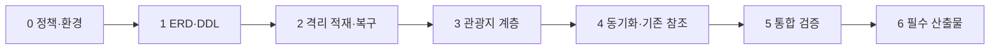

# 단계별 구현 계획

이번 작업은 이 계획 작성까지다. 아래의 SQL·소스·테스트·산출물 경로는 **후속 수정/신규 생성 대상**이며, 현재 생성·수정 완료된 것으로 해석하지 않는다. B안(기존 구조·ID 보존 및 제공 데이터 변환 적용)을 기준으로 한다.

Java 경로는 `src/main/java/kr/co/enjoytrip/`, 화면은 `src/main/webapp/WEB-INF/views/` 기준이다. 신규 파일명은 제안이며 저장소 규칙에 따라 확정한다. 한 단계의 실행 증거 없이 다음 단계의 완료를 선언하지 않는다.

## 0. 명세·데이터 정책과 검증 환경 확정

**선행:** [요구사항·확인 목록](01-requirements.md) 검토. Q1~Q2 사용자 답변은 이미 반영했으므로 같은 원형 사용/보존 결정을 다시 요청하지 않는다.

**작업:**

1. B안의 모델·변환·기존 기능 유지 범위를 합의 기록에 남긴다. Q3의 덤프/API 충돌 우선순위, Q4의 39번 이름 보정, 0 좌표 처리 등 변환 정책을 확인한다.
2. Q5의 MySQL 정확한 버전·sql_mode·문자셋·FK 관련 설정·계정 권한과 격리 DB 환경을 준비한다. 명세의 MySQL 사용과 실제 설치 상태를 구분한다.
3. 제공 자료의 해시·크기·덤프 주석 시점과 [정적 집계](01-requirements.md#제공-erdddl덤프-정적-검토)를 기준으로 남긴다. `trip-model.mwb`는 보조 편집 자료이며, 이번 분석은 제공 PNG와 SQL을 기준으로 했다.
4. 기존 데이터 보존 목록(9개 테이블, 관광지 content_id↔id, 계획·사진 참조, 업로드 파일), 검증용 복제 방식, 전환 시 쓰기 중지 방법을 정한다. 실데이터는 필요 최소한으로 비식별화한다.
5. 실행 JDK 21을 확인한다. 분석 시 기본 PATH의 `java`는 Java 8 설치 경로를 가리켰으며, 이는 프로젝트 요구 버전과 다르다. 이 상태에서 Maven 검증 실패를 코드 결함으로 판정하지 않는다.

**파일:** `docs/db/`의 결정 상태 갱신. 필요 시 후속 `deliverables/db/README.md`에 환경/정책 기록 공간을 마련한다(제출 위치는 Q8 후 확정).

**완료:** 미결정 정책·환경과 승인된 정책이 분리되어 있고, 원본을 기존 DB에 직접 실행하지 않는 구체적 절차가 검토 가능하다. 미결정 정책에 의존하지 않는 모델·DDL 초안 작업은 계속 가능하다. **검증:** 담당자 검토, 원본 해시와 정책 체크, 연결 대상 식별. 현재 DB 초기화는 하지 않는다.

## 1. 전체 ERD·DDL·마이그레이션 설계

**선행:** B안 방향(완료), 기존 DDL 분석. 데이터 보정 내용은 0단계 결정 후 확정한다.

**작업:**

1. 기존 9개 테이블과 기준정보 3개를 포함한 전체 ERD를 작성한다. 키의 물리 타입, FK·UNIQUE, NULL, DEFAULT, 삭제 정책을 컬럼 수준으로 맞춘다.
2. 시도·유형의 자연키 참조와 구군 `(sido_code,gugun_code)` 복합 UNIQUE, 관광지 `(area_code,sigungu_code)` FK를 설계한다. `gugun_code` 단독 UNIQUE는 만들지 않는다.
3. **신규 설치 DDL**과 **기존 DB 업그레이드**를 분리한다. `CREATE TABLE IF NOT EXISTS`는 기존 테이블의 컬럼/FK를 변경하지 않으므로 업그레이드를 대신하지 못한다.
4. 기존 데이터 코드 검증→기준정보 생성/입력→필요한 구군 보충→FK 추가 순서를 정의한다. 불일치가 있으면 명시적 중단·진단 결과를 내고 자료 확인 후 재개한다.
5. 기존 사용자 콘텐츠 DDL·역할·CASCADE·게시판 kind를 유지한다. 원본/앱 간 명칭·타입·정밀도 차이는 [필드 대응표](02-architecture.md#관광지-필드-대응)로 추적한다.

| 파일 | 작업 |
| --- | --- |
| `src/main/resources/schema.sql` | 후속 신규 설치용 전체 DDL에 기준정보와 관계 추가. 기존 DB에는 업그레이드 절차를 사용 |
| `src/main/resources/db/migrations/001-db-extension.sql`（신규안） | 기존 DB 사전조건·명시적 변경·적용 확인. 초기 데이터와 FK 추가의 순서를 구간으로 구분 |
| `src/main/resources/db/seed/lookup-data.sql`（신규안） | 제공 기준정보의 자연키 기반 입력. 승인된 명칭 보정은 원본과 구분 |
| `deliverables/db/erd.md` 및 ERD 이미지/편집본（후속안） | 전체 12개 테이블 ERD와 원본 대비 개선 이유 |

**완료:** 신규/업그레이드 경로가 같은 목표 스키마에 도달하도록 설계되고, 제공 구군 관계의 문제와 개선 이유가 설명된다. **검증:** ERD↔DDL 대조, 타입·참조 인덱스·부모키 확인, 아직 데이터 검증 전인 FK 적용 단계 표시.

## 2. 격리 적재·변환·복구 절차 구현

**선행:** 0단계 정책·환경, 1단계 DDL. 원본 실행은 정확한 대상 환경을 확인한 뒤 후속 작업에서만 수행한다.

**작업:**

1. 격리 인스턴스에서 제공 Schema→Dump를 로드한다. MySQL 호환 문제가 있으면 원본 컬럼 순서를 유지한 파생DDL과 변경 이력을 사용한다. 원본을 몰래 고치지 않는다.
2. 17/234/8/50,915건과 코드별 분포를 DB에서 재현한다. LOCK TABLES·세션 설정·오류 종료 시 상태를 확인하고, 검사 해제 후 재활성화만으로 무결성 증명이 된다고 간주하지 않는다.
3. 승인된 39번 명칭 보정·좌표 결측 처리·주소/설명 변환을 적용한다. 기존 비어 있지 않은 설명·사진·갱신 시각을 보호한다. 변환 예정 건수/경쟁 목록을 먼저 출력한다.
4. `content_id` 기준 기존 행은 ID 유지, 신규는 새 ID 생성. 기존 관광지를 `REPLACE`하거나 전부 지웠다 넣지 않는다. 다중 DML은 검증된 트랜잭션 단위로 나누고 각 구간의 기록을 남긴다.
5. dump에 없는 기존 관광지는 유지한다. 기준정보 불일치·NULL ID·중복은 자동 추정/삭제하지 않고 작업을 중단한다.
6. 재적재와 실패 후 재실행에서 중복이 없는지 확인한다. DDL은 트랜잭션 ROLLBACK만으로 복구하지 않고 백업·스키마 복원 절차를 별도 검증한다.

| 파일 | 작업 |
| --- | --- |
| `src/main/resources/db/import/import-trip-source.sql`（신규안） | 원본 검증 환경→기존 앱으로 명시적 컬럼 변환·병합, 사전조건·결과 집계 |
| `src/main/resources/db/validation/verify-db.sql`（신규안） | 건수·중복·고아·변환·기존 FK 보존·인덱스 검증용 조회 |
| `src/main/resources/db/seed/demo-data.sql`（신규안） | 시연 계정·계획·방문지·공지/게시글 등. 비밀번호는 기존 해시 방식 사용, 실제 정보 미포함 |
| 후속 DB README·검증 기록 | 백업/복원, 적재 순서, 중간 실패·재실행, 파일/사진 준비·제거 절차 |

Hot Place 시연 사진은 검증용 업로드로 준비하고 DB의 상대 경로와 실제 파일이 대응해야 한다. SQL만으로 사진이 생기는 것처럼 기록하지 않는다. 뉴스·부가 정보 더미를 운영 테이블/캐시에 상시 혼합하지 않고 테스트 대역으로 분리한다.

**완료:** 격리 환경 적재 성공, 합의한 병합 결과와 실제 건수 일치, 기존 id/FK·비관련 테이블/사진 보존, 재실행 중복 0, 복원 연습 성공. **검증:** [DB-검증 시나리오](04-test-plan.md#초기-적재와-데이터-정합성) 및 SQL 결과 저장.

## 3. 기준정보·관광지 계층 연계

**선행:** 목표 컬럼·코드·테스트 데이터가 검증된 2단계. 기능별 연결 순서는 Dto→Dao→Service→Controller→JSP다.

| 수정/신규 대상 | 작업 | 단계 완료 조건 |
| --- | --- | --- |
| `dto/AttractionDto.java` | nullable `Integer sigunguCode` 추가. 모든 생성부/컴파일 영향 확인 | NULL/0/정상 구군 구분, 기존 필드명·JSP 호환 |
| `external/TourApiClient.java` | 같은 단계에서 구군 nullable 파싱과 Dto 생성부를 함께 변경 | Dto 시그니처 변경 후에도 컴파일 가능. 미등록 양수 코드는 자동 보정하지 않음 |
| `dto/SidoDto.java`, `GugunDto.java`, `ContentTypeDto.java`, `dao/LookupDao.java`（신규안） | 시도·구군·타입 조회/존재 확인, 구군은 부모시도 필수 | 제공 기준정보 조회 가능, 다른 시도의 같은 구군 코드가 섞이지 않음 |
| `dao/AttractionDao.java` | 명시적 SELECT와 구군 매핑, INSERT/UPDATE/배치 동기화 반영 | 필터·상세·사진·upsert에서 id/content_id 혼동 없음 |
| `service/AttractionService.java` | 기준정보 제공, 코드 검증, 최대 10건 자동완성 및 읽기 전용 `findStored` 메서드 | 기존 조회 규칙 유지, 부가 API 조회에 설명 수집 부작용 추가 없음 |
| `controller/AttractionController.java`, `attractions.jsp` | 선택지 하드코딩을 기준정보 조회로 교체 | 검색값은 no가 아닌 region/type 코드, 20건 페이지·조건 유지 |
| `controller/AttractionSearchController.java`, `controller/InfoController.java` | 관광지 접근을 Service 경유로 변경 | 검색 JSON 최대 10건·id/title 유지, 부가 API 동작 유지 |
| `attraction-detail.jsp` | 적재 데이터의 설명·대표사진·미상 갱신 시각·위치 없음 안내를 확인하고 필요한 부분만 보완 | NULL이 문자열로 노출되거나 0좌표 지도를 표시하지 않음 |

`region/type` 허용값 검증은 기존 동작의 명확화다. 숫자 변환 실패는 400, 등록된 코드의 결과 없음은 빈 목록을 유지하며, 미등록 정수 코드는 400으로 처리하는 안을 제안한다. 이 변경은 신규 기능으로 포장하지 않고 HTTP 경계 계약으로 검증한다.

**완료:** 제공 데이터로 F101~F103과 기존 여행지 검색·상세·사진 조회가 이어진다. **검증:** 새 코드에 필요한 DAO 통합 검증·Service 경계·Servlet/JSP 검증. 경로·응답 변경이 없다면 모든 화면을 재작성하지 않는다.

## 4. 동기화·참조·기존 기능 보존 검증

**선행:** 3단계 완료. 정기·수동 동기화가 검증용 데이터를 임의 갱신하지 않도록 실행 조건을 통제한다.

| 대상 파일 | 작업과 검증 |
| --- | --- |
| `external/TourApiClient.java` | 3단계에서 반영한 구군 파싱·Dto 생성을 빈/NULL·미등록 양수 코드 대역으로 검증 |
| `dao/AttractionDao.java`, `service/AttractionService.java` | 신규/기존 관광지 동기화에서 id/FK 보존, 제약 충돌 시 명확한 오류, 배치 실패 롤백 |
| `config/AppLifecycle.java` | 기존 두 예약 작업과 관리자 동기화 시작점을 확인. 검증/전환 시 앱 중지 등으로 동시 쓰기 방지. 자동화에 필요하면 명시적 동기화 활성 설정의 최소 추가를 검토 |
| `dao/PlanDao.java`, `service/PlanService.java`, `controller/PlanController.java` | 기본적으로 변경 없이 회귀 확인. JOIN·방문지 추가/삭제·순서변경·공개/비공개 검증 |
| `attraction_images`와 사진 관련 코드 | 기존 FK·대표사진·갤러리 보존, API 부재 시 기본 상세 유지 |
| 회원·Hot Place·뉴스·게시판·공지·Filter·사진 배포 | 기존 DB/파일과 권한 유지. 불가피한 회귀 결함이 발견될 때만 필요한 파일 수정 |

**완료:** 같은 데이터를 반복 수집해도 관광지/사진이 불필요하게 중복되지 않고 기존 계획·사진의 대상이 바뀌지 않는다. 외부 실패가 DB 기본 조회를 막지 않는다. **검증:** 동기화 대역 정상/빈/오류/미등록 코드, 제한된 실제 키 검증, 기존 기능의 주요 흐름과 권한 검증.

실제 API 검증이 키·활용 승인 문제로 미수행이면 해당 항목을 ‘확인 필요’로 남긴다. 대역 테스트 통과를 실연동 통과로 기록하지 않는다.

## 5. 회귀·성능·복구 최종 검증

**선행:** 2~4단계 완료. 신규 설치·업그레이드 두 경로를 모두 검증할 수 있는 DB/파일 기준선.

1. [테스트 계획](04-test-plan.md)의 DB·기능·권한·페이지·결측·트랜잭션·복구 시나리오를 수행한다.
2. 기존 4개 단위 테스트에 DB 통합 검증을 보강한다. 환경 차이로 인한 실패와 실제 코드 결함을 구분한다. DB 테스트는 운영 접속정보로 실행하지 않는다.
3. 제공 규모에서 실행계획과 측정값을 기록한다. 측정 근거가 있을 때만 인덱스 추가를 검토하며, 근거 없는 SLA나 FULLTEXT 도입을 추가하지 않는다.
4. 실제 기존 ID/FK·회원/작성자·비공개 범위·사진 경로가 보존되는지 전후 비교한다.
5. 마이그레이션 실패와 이전 WAR/백업 복원 후 조회를 검증한다. DDL+DML이 일괄 원자적이라고 가정하지 않는다.

**파일:** 후속 `src/test/java/kr/co/enjoytrip/dao/AttractionDaoIntegrationTest.java`, `LookupDaoIntegrationTest.java`, 필요한 관광지 Service 검증, DB 검증 스크립트·결과 기록. 테스트 이름/도구는 설계 제안이다. 현행 pom 변경은 통합테스트 분리 실행에 실제 필요한 경우로 한정한다.

**완료:** 관련 시나리오가 통과하고 미수행 외부 검증은 원인·준비사항·담당 작업을 명시한다. 주요 DB 불일치·참조 손실·권한 회귀가 남아 있으면 완료 처리하지 않는다.

## 6. 필수 산출물과 제출 준비

**선행:** 구현과 최종 검증 완료, Q8의 실제 제출 규칙 확인.

| 후속 산출물 후보 | 내용·완료 조건 |
| --- | --- |
| `deliverables/db/README.md` | 목표·환경·실행/적재/업그레이드/복구 순서, 명세 대응, 검증 상태·아래 자료 링크 |
| `deliverables/db/erd.*` | 최종 12개 테이블 모델·복합 구군 관계·사용자 FK·원본 대비 개선. 실제 DDL과 일치 |
| `deliverables/db/schema.sql` | 검증된 신규 설치 DDL. 원본 관광지 DDL만을 전체 DB인 것처럼 제출하지 않음 |
| 초기·더미·마이그레이션/검증 자료 | 구동에 필요한 데이터·파일 준비, 재실행/오류 처리, AI 정적 검토와 실행 검증의 차이 |
| 최종 소스와 `deliverables/db/screenshots/` | 확장 DB에서 실행한 관광지·필터·회원·계획/사진·권한 등 화면, 조건/일시/대상 기록. 기존 캡처 재사용만으로 완료하지 않음 |

이름과 위치는 제안이며 신규 PDF가 요구한 고정 경로는 아니다. 기존 `deliverables/back/`는 과거 산출물로 보존한다. 신규 Usecase/Class Diagram은 신규 PDF 필수 산출물이 아니며 필요시 기존 자료의 변경 부분만 갱신한다.

**완료:** 신규 PDF p.15~16의 README·ERD·DDL·소스/실행화면 모두 접근 가능하고, 새 환경에서 절차가 재현된다. `.env`·개인정보·로컬DB·실제 업로드가 포함되지 않고 `temp/` 제외 때문에 제출에 필요한 링크가 깨지지 않는다. GitLab 업로드는 후속 제출 업무이며 이번 문서 작성 작업에서는 수행하지 않는다.

## 단계 간 의존성과 현재 진행 상태

전체 모델 초안과 제출 README의 골격은 정책 미결정 중에도 작성 가능하다. 단, 미결정 데이터 보정·실제 DB 전환·제출을 선행 완료한 것처럼 처리하지 않는다. **현재는 0~6단계의 구현 계획을 작성한 상태이며 실제 구현은 미착수다.** 명세의 예상 시간(필수 5H·추가 2H·심화 1H)은 교육용 참고값이며 이번 DB 전환의 확정 견적/기한으로 사용하지 않는다.
